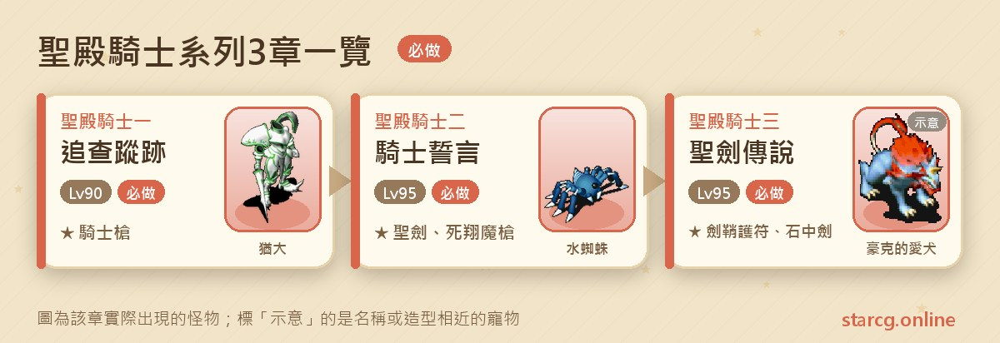
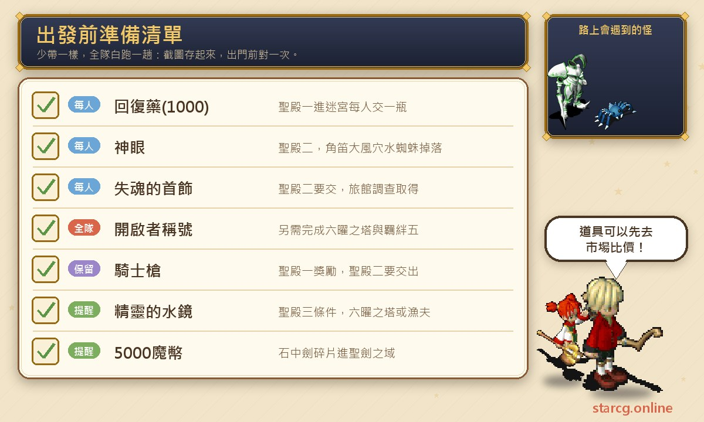
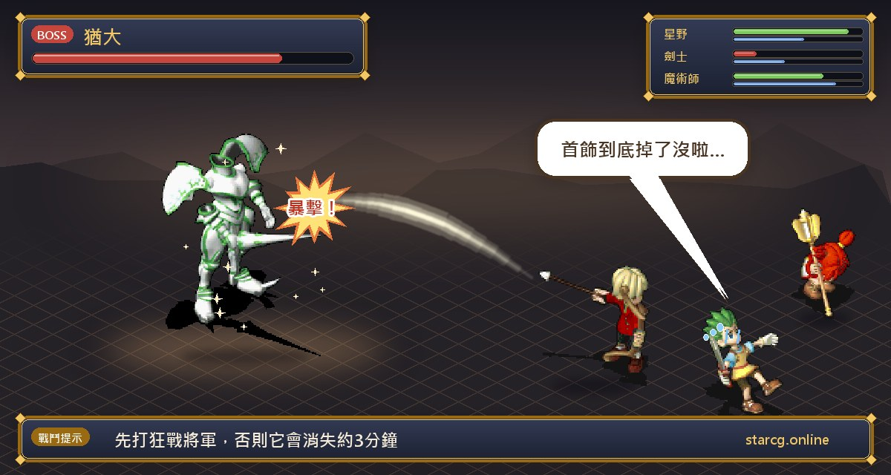
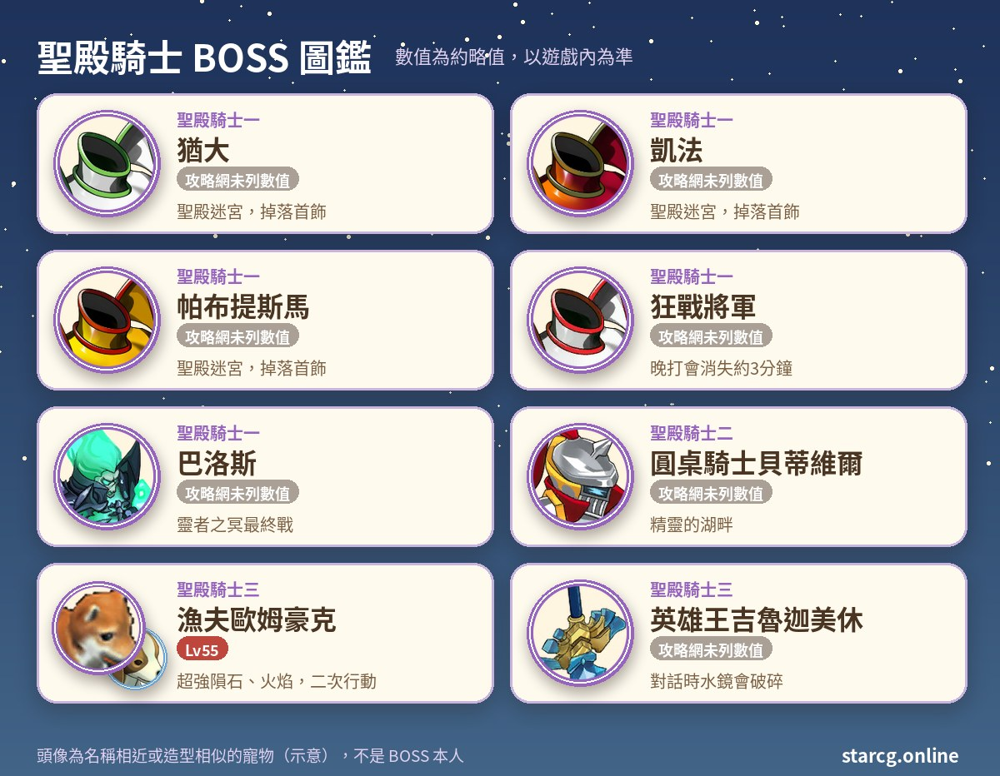

魔力寶貝的聖殿騎士系列，是一條以圓桌騎士與聖劍為題材的高等級劇情任務：從法蘭皇宮的士兵長克魯斯發出「勇者召集令」開始，你會先在聖殿迷宮打倒猶大、凱法、帕布提斯馬、狂戰將軍與巴洛斯，接著在精靈的湖畔與圓桌騎士交手、拿到聖劍，最後闖進巴比倫之門面對英雄王，向騎士王交出聖劍與劍鞘。整個系列共三章，第一章推薦 90 級，後兩章推薦 95 級。

聖殿騎士任務的終點獎勵有兩樣：一個是**誓約之劍鞘的護符**，Lv.10 的不可交易護身符，附帶「諸刃 +20% 傷害」特效；另一個是**石中劍的碎片**，可以重複使用的通行道具，交 5000 魔幣就能進入「聖劍之域」練功與捉寵。不論你玩的是星詠魔力、水藍魔力還是初心魔力寶貝，聖殿騎士系列的任務流程都是一樣的，這份整理都能直接拿來用。

> 本文整理自 [星詠魔力攻略網](https://guide.starcg.net/) 的聖殿騎士系列頁面，並用我們自己的方式重新排序與改寫，沒有逐字照搬。攻略網這個系列大部分 BOSS 沒有列出等級、血量與技能，本文也不會自行補上；數值以遊戲內為準，遊戲更新後內容可能變動。

## 聖殿騎士系列是什麼？先看整體順序

聖殿騎士系列只有三章，但門檻很高：第一章就要求完成「六曜之塔」與「羈絆五－永遠」，並擁有「開啟者」稱號。也就是說，這條任務線基本上是給已經把羈絆系列走完的玩家，接在後面繼續推進的高等內容。三章之間用武器串起來：聖殿騎士一拿到的騎士槍，是聖殿騎士二的條件；聖殿騎士二拿到的聖劍，則是聖殿騎士三的條件。

| 章節 | 任務名稱 | 推薦等級 | 取得 |
|---|---|---|---|
| 聖殿騎士一 | 追查蹤跡 | 90 | 騎士槍（每人一把）、聖殿首飾（低機率） |
| 聖殿騎士二 | 騎士誓言 | 95 | 聖劍、死翔魔槍 |
| 聖殿騎士三 | 聖劍傳說 | 95 | 誓約之劍鞘的護符、石中劍的碎片 |

攻略網在聖殿騎士一、二兩頁都標示「支援自動導航」，對地點不熟的話可以善加利用。

## 出發前先準備好這些

聖殿騎士系列的準備重點是「每個人都要有」的道具：第一章每人一瓶藥水，第二章每人一個神眼、一個失魂的首飾，少一個人就卡在門口。

「生命力回復藥 (1000)」是第一章進迷宮的門票，每人一瓶，交出去就沒了，建議每個人多帶一瓶備用。藥水與第三章可能用到的醋飯壽司都可以先用本站的 [市場查價](/market/) 比價再買。神眼只能自己到角笛大風穴打水蜘蛛取得，失魂的首飾則要做「旅館調查」任務，這兩樣最花時間，最好在開始聖殿騎士二之前就讓全隊備齊。

## 聖殿騎士一：追查蹤跡（聖殿迷宮與四種首飾）

推薦 90 級。條件是完成「六曜之塔」、「羈絆五－永遠」，並擁有「開啟者」稱號（完成任務「開啟者」取得）。

1. 到法蘭皇宮一樓，找**士兵長克魯斯**（81, 19）對話，拿到【勇者召集令】。
2. 確認**全隊每人都帶著一瓶「生命力回復藥 (1000)」**，在**夜晚**前往毀滅之村，找石碑旁的**受傷的老人**（36, 57）對話。
3. 每人交出一瓶藥水，全隊被傳送到**聖殿迷宮**。
4. 在迷宮中擊敗四名 BOSS：**猶大、凱法、帕布提斯馬、狂戰將軍**。
5. 四名 BOSS 會掉落**蒼冥首飾、龍火首飾、戰神首飾、天墜首飾**四種首飾。首飾可以丟在地上或交易，**只需要隊長一個人集齊四種**，不必每人都收一套。
6. 隊長到狂戰將軍身後的**結界**對話，交出四種首飾，進入「靈者之冥」。
7. 找**巴洛斯**對話，開始最終 BOSS 戰。
8. 打贏巴洛斯後，**每人拿到一把騎士槍**，被傳回毀滅之村，完成。

**要注意的地方**：

- 沒帶藥水的人進不了迷宮，出發前務必每人確認一次。
- 毀滅之村要在**夜晚**去。
- **擊殺順序很重要**：如果先擊倒猶大、凱法或帕布提斯馬，狂戰將軍會消失約 3 分鐘才重生。攻略網的說法是可以等待重生，或是調整擊殺順序；換句話說，先處理狂戰將軍再去打另外三位，可以省下等待時間。
- 首飾只要隊長集齊即可，隊員打到的首飾直接交給隊長就好。
- **騎士槍不要丟**，聖殿騎士二的條件就是它。

**隱藏獎勵**：擊敗巴洛斯時有低機率掉落「**聖殿騎士團徽章**」，持有者可以交給克魯斯換取**聖殿首飾**。攻略網把聖殿首飾列為稀有道具，沒有寫出它的數值。

**BOSS 資料**：攻略網這一頁沒有列出猶大、凱法、帕布提斯馬、狂戰將軍與巴洛斯的等級、血量與技能，也沒有寫聖殿迷宮的層數。推薦等級是 90 級，建議以這個等級為準組隊；實際強度以遊戲內為準。

## 聖殿騎士二：騎士誓言（取得聖劍）

推薦 95 級，條件是持有【騎士槍】。這章主要是交接道具，準備好神眼與失魂的首飾就能順順走完。

1. 到**夜之蒂娜村**醫院前找**老人**對話，選擇同意，交出騎士槍，拿到【斷槍頭】。
2. 回法蘭城，到城堡 2 樓的騎士就職房間，找**流浪騎士蘭斯洛特**，交出斷槍頭，拿到【魔槍槍頭】。
3. 全隊準備**神眼**與**失魂的首飾**（每人都要）：神眼在角笛大風穴打倒隨機出現的水蜘蛛取得；失魂的首飾做「旅館調查」任務取得。
4. 回夜之蒂娜村，隊長持魔槍槍頭與神眼，到**石碑**（38, 31）對話並交出神眼，傳送到**圓桌的大廳**。
5. 找**圓桌騎士蘭斯洛特**，交出魔槍槍頭與失魂的首飾，拿到【死翔魔槍】。
6. 進入**妖精的森林**，穿過迷宮，抵達**精靈的湖畔**。
7. 找**圓桌騎士貝蒂維爾**對話開戰。
8. 打贏後找「**劍？**」對話，拿到【聖劍】。
9. 到精靈的湖畔深處找**騎士王**對話，回到法蘭城，完成。

**要注意的地方**：

- 水蜘蛛是**隨機出現**的，可能要多跑幾次才能讓全隊都拿到神眼。如果你做過黑白漩渦系列，應該對這段不陌生，黑白一同樣要每人一個神眼。
- 失魂的首飾**每人都需要**，有人沒做過「旅館調查」的話，要先補做。
- 攻略網註明**死翔魔槍是下一章的任務道具**；不過聖殿騎士三的頁面步驟沒有再提到它，保險起見還是先留在身上。
- 攻略網沒有列出圓桌騎士貝蒂維爾的戰鬥資料，也沒有列出聖劍與死翔魔槍的數值。

## 聖殿騎士三：聖劍傳說（英雄王與誓約之劍鞘）

推薦 95 級。條件是持有【聖劍】與【精靈的水鏡】，攻略網另外列出需完成「六曜之塔」（聖殿騎士一已要求過）。精靈的水鏡可以從「六曜之塔」任務取得，也可以照下面第 1 步向漁夫拿。

1. **取得精靈的水鏡**：到伊爾村找**漁夫歐姆豪克**（31, 45）對話。他會依序問你要不要用以下東西交換水鏡，任何一題選「是」就直接拿到：
   - 用 **10000G** 買下；
   - 用一組**醋飯壽司**（R9 料理，魔力回復約 850 點）交換；
   - 用**魔族的水晶**交換；
   - 三題都拒絕的話，最後會問你要不要打架，選「是」就開戰，打贏後隊伍中**隨機一人**拿到水鏡。
2. 到法蘭王宮二樓的騎士就職處，找**流浪騎士蘭斯洛特**對話，傳送到**巴比倫之門**。
3. 找**英雄王吉魯迦美休**對話開戰。**對話時身上的精靈的水鏡會破碎**。
4. 打贏後被送到**王之財寶**，和**劍鞘**對話選「確定」拿到劍鞘，再被送到召喚之間。
5. 回到夜之蒂娜找**老人**對話，被傳送到精靈的湖畔。（劇情步驟可以省略，直接找圓桌騎士貝蒂維爾對話。）
6. 到精靈的湖畔深處找**騎士王**，交出聖劍與劍鞘，拿到【騎士王的祝福】。
7. 回騎士就職的屋子，再找**蘭斯洛特**對話領取最終獎勵，完成。

**BOSS 資料**：

- **漁夫歐姆豪克**：55 級，二次行動，會攻擊、防禦、超強隕石魔法、超強火焰魔法（攻略網未列血量）。
- **豪克的愛犬** ×4：都是 55 級、約 3,000 血、二次行動，都會**裝備破壞**。四隻的屬性與招式不同：火 6 風 4（崩擊）、水 6 火 4（連擊）、地 6 水 4（戰慄襲心）、風 6 地 4（諸刃）。
- **英雄王吉魯迦美休**：攻略網沒有列出等級、血量與技能。

**打法與提醒**：歐姆豪克這場等級不高，但愛犬會裝備破壞，不想冒裝備被打壞的風險，可以直接用 10000G、醋飯壽司或魔族的水晶換水鏡。攻略網另外提到，星詠魔力已經取消寵物改造任務，所以「偷狗」（捕捉豪克的愛犬）沒有實際用途，不需要特地準備。

**獎勵說明**：

- **誓約之劍鞘的護符**：Lv.10 護身符，不可交易，耐久 150～250，防禦 10～50、敏捷 4～20、生命 40～120、魔法 10～50、必殺 0～3、反擊 3～15，特殊效果「**諸刃 +20% 傷害**」。數值是區間，每個人拿到的會不一樣。
- **石中劍的碎片**：特殊通行道具，持有並交出 **5000 魔幣**就能進入「**聖劍之域**」練功與捉寵，**可以重複使用**。在聖劍之域捉到的寵物，可以到本站的 [寵物圖鑑](/pets/) 查詢成長與資料。

## 聖殿騎士系列常見問題

**聖殿騎士任務的前置條件是什麼？** 聖殿騎士一要求完成「六曜之塔」、「羈絆五－永遠」，並擁有「開啟者」稱號。羈絆系列還沒做完的話，要先把羈絆一到五走完。

**聖殿迷宮的四種首飾要每人收一套嗎？** 不用。四種首飾只需要隊長集齊，首飾可以丟地上或交易，隊員打到的交給隊長即可。

**狂戰將軍為什麼不見了？** 如果先擊倒猶大、凱法或帕布提斯馬，狂戰將軍會消失約 3 分鐘才重生。可以原地等待，或下次調整擊殺順序。

**精靈的水鏡一定要打漁夫嗎？** 不一定。漁夫會先問你要不要用 10000G、醋飯壽司或魔族的水晶交換，任何一樣答應就能拿到；也可以從「六曜之塔」任務取得。

**石中劍的碎片用完會消失嗎？** 攻略網註明石中劍的碎片可以重複使用，每次進入聖劍之域要交 5000 魔幣。

## 小結：先湊齊每人道具，再一口氣推完

聖殿騎士系列只有三章，流程本身不算長，真正花時間的是前置：六曜之塔、羈絆五、開啟者稱號，以及聖殿騎士二每人都要的神眼與失魂的首飾。建議先確認全隊條件，再依序推進：第一章記得每人帶藥水、夜晚出發、注意狂戰將軍的擊殺順序；第二章把神眼與首飾準備齊；第三章視情況決定要不要直接花錢換水鏡。走完之後拿到的誓約之劍鞘的護符與可重複使用的石中劍的碎片，都是長期用得到的東西。

想看更完整的原文，可以到 [星詠魔力攻略網](https://guide.starcg.net/) 查詢聖殿騎士系列各頁；也歡迎用本站的 [市場查價](/market/) 與 [寵物圖鑑](/pets/)，把準備道具與聖劍之域捉寵的行程安排得更順。
