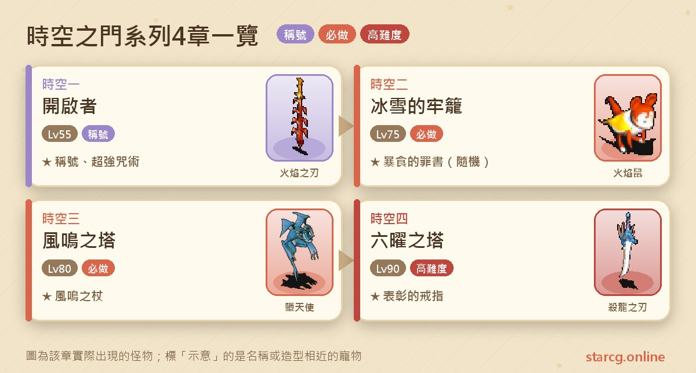
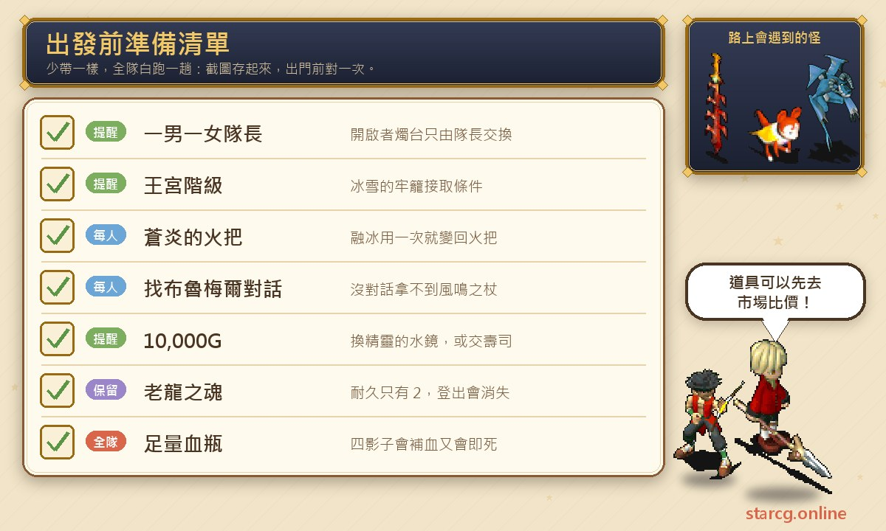
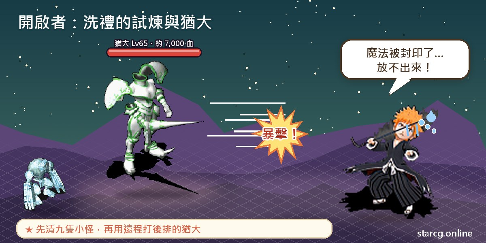
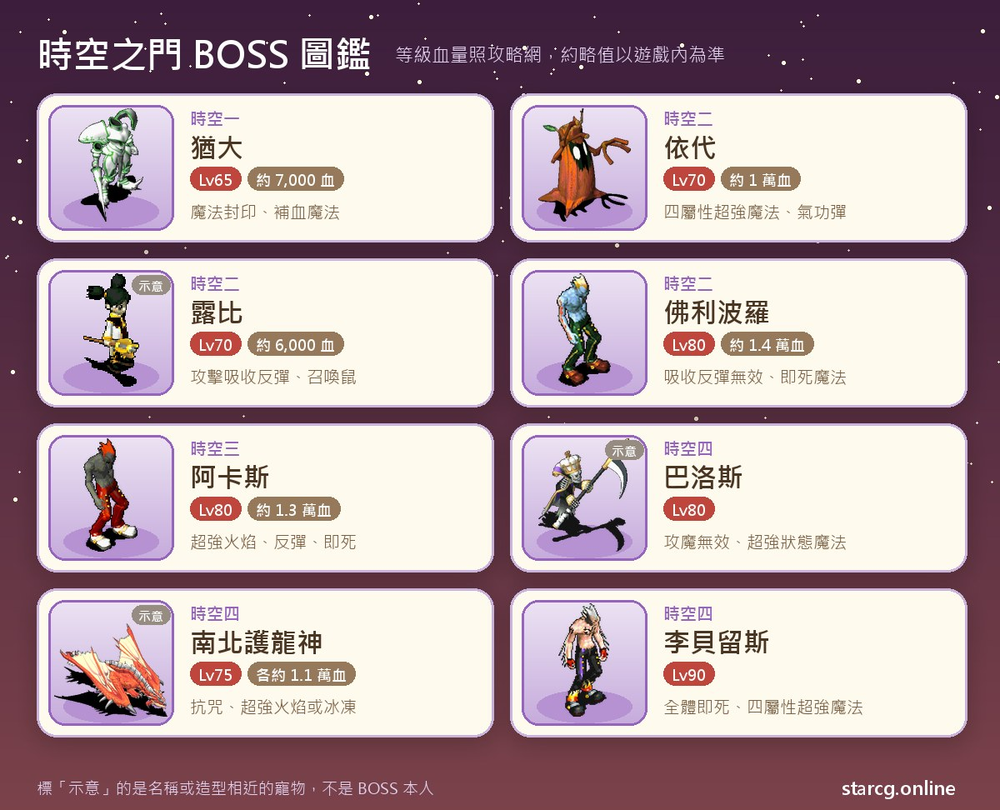

시공의 문(時空之門)은 크로스게이트에서 아스티아 마을(阿斯提亞鎮)을 중심으로 펼쳐지는 퀘스트 라인이에요. 세레네(莎蓮娜)섬의 시련의 길(試煉之道)에서 시작해 빙설의 감옥성(冰雪的牢城), 바람 울리는 탑(風鳴之塔)을 지나, 마지막에는 육요의 탑(六曜之塔)에 들어가 리벨리우스(李貝留斯)와 그 휘하의 프리볼로(佛利波羅), 아카스(阿卡斯), 바로스(巴洛斯)를 상대해요. 시리즈는 총 4장이고 권장 레벨은 55에서 90까지예요. 1장 「여는 자(開啟者)」를 마치면 돈을 내고 여섯 가지 **전체 초강력 주술 마법**을 배울 수 있고, 2장에서는 1등 훈장에 필요한 **폭식의 죄서(暴食的罪書)**가 나올 수 있으며, 마지막 장에서는 **표창의 반지(表彰的戒指)**와 칭호 「운명에 맞서는 자(對抗命運的人)」를 받을 수 있어요.

이 글은 4장의 조건, 좌표, 챙길 물건, 보스전마다의 레벨과 HP를 플레이하면서 바로 펼쳐 볼 수 있는 흐름으로 정리했고, 촛대 교환, 창염의 횃불, 늙은 용의 혼처럼 가장 막히기 쉬운 장치는 따로 꺼내 설명했어요. StarCG(星詠魔力)든 水藍魔力든 初心魔力寶貝든 시공의 문 퀘스트 흐름은 똑같아서(StarCG는 여는 자의 파티 조건이 간소화되어 있어요. 아래에 따로 적었어요) 이 정리를 그대로 쓰면 돼요.

> 이 글은 [StarCG 공략 사이트](https://guide.starcg.net/)의 시공의 문 시리즈 페이지를 바탕으로 水藍魔力 공략 wiki의 육요의 탑 페이지를 참고해 저희 방식대로 순서를 다시 정리하고 새로 쓴 것으로, 그대로 옮기지 않았어요. 보스 HP와 수치는 대략적인 값이니 실제 게임을 기준으로 해 주세요. 게임 업데이트 후 내용이 바뀔 수 있어요.

## 시공의 문이란? 먼저 전체 순서부터

시공의 문 4장은 순서대로 열려요. 여는 자는 먼저 「신수 도전(挑戰神獸)」을 마쳐야 하고, 얼음의 감옥(冰雪的牢籠)은 「여는 자」 칭호와 왕궁 계급이 필요하며, 바람 울리는 탑은 얼음의 감옥 완료, 육요의 탑은 바람 울리는 탑 완료와 70레벨 이상이 조건이에요. 장마다 나온 보스가 마지막 장에서 다시 등장하니, 앞에서 쌓은 공략 경험이 마지막에도 쓸모가 있어요.

한 문장으로 정리하면: **여는 자는 두 리더의 호흡, 얼음의 감옥은 횃불, 바람 울리는 탑은 암호, 육요의 탑은 늙은 용의 혼 지키기예요.**

| 장 | 퀘스트 이름 | 권장 레벨 | 획득 |
|---|---|---|---|
| 시공의 문 1 | 여는 자 | 55 | 칭호 「여는 자」, 전체 초강력 주술 6종 습득 가능 |
| 시공의 문 2 | 얼음의 감옥 | 75 | 폭식의 죄서(랜덤), 프리볼로 전송 지점 개방 |
| 시공의 문 3 | 바람 울리는 탑 | 80 | 풍명의 지팡이, 풍명의 깃털(랜덤 1명) |
| 시공의 문 4 | 육요의 탑 | 90 | 표창의 반지, 칭호 「운명에 맞서는 자」 |

## 출발 전에 챙길 것

시공의 문의 전투 난도는 중간 정도지만, 장마다 「없으면 막히는」 조건이나 아이템이 하나씩 있어요. 아래 그림에 장별로 챙길 것을 모아 두었으니 캡처해 두세요.

돈은 여는 자에서 초강력 주술을 배우는 데 10,000G가 들어요. 육요의 탑의 정령의 수경(精靈的水鏡)은 10,000G를 내거나 초밥(醋飯壽司) 한 세트, 또는 마족의 크리스탈(魔族的水晶)을 내고 받을 수 있어요. 공략 사이트는 얼음의 감옥과 바람 울리는 탑 모두에서 「회복약을 충분히 챙기라」고 특별히 강조해요. 네 그림자가 회복도 하고 즉사도 써서 전투가 대체로 길어지거든요. 출발 전에 사이트의 [시세 검색](/ko/market/)으로 회복약, 초밥, 마족의 크리스탈 가격을 비교해 보고 수경을 어떤 방법으로 받을지 정하세요.

## 시공의 문 1: 여는 자(촛대 교환과 유다)

조건은 「신수 도전」 완료, 권장 55레벨이에요. 원래는 남자만 꽉 찬 파티와 여자만 꽉 찬 파티 두 팀이 필요하지만, **StarCG는 남녀 리더 한 명씩만 있으면 되고** 촛대 교환도 두 리더만 해요.

1. 세레네섬(제노바 마을(傑諾瓦鎮) 근처)의 **아스티아 신관(阿斯提亞神官)**(260, 360)을 찾아 시련의 길에 들어가요. 미궁 안의 파란 점은 남성 경로, 빨간 점은 여성 경로, 보라 점은 공통 경로예요.
2. 아스티아 마을에 도착하면 대홀에서 **크리스프도 사제(克里斯夫多祭司)**(26, 23)를 찾아 성찬의 방(聖餐之間)으로 이동한 뒤 **아스티아 신관**(40, 12)을 찾아요. 이후 남녀 리더가 각자의 성단 경로로 나뉘어 가요.
3. **첫 번째 교환**: 남자 리더는 (27, 30) 계단으로 가서 **에오키아(艾奧其亞)**에게 「맹세의 촛대(빨강)(誓言的燭台（紅）)」를 받고 (71, 41) 근처로, 여자 리더는 (24, 76) 계단으로 가서 **디오메야(迪歐梅雅)**에게 「맹세의 촛대(파랑)」를 받고 (72, 49) 근처로 가서 서로 교환해요.
4. **두 번째 교환**: 남자 리더는 (106, 26)의 **에메스(艾梅斯)**에게 이동한 뒤 (90, 44) 근처로, 여자 리더는 (109, 34)의 **프레야트(芙蕾雅特)**에게 이동한 뒤 (90, 52) 근처로 가서 교환해요.
5. **세 번째 교환**: 남자 리더는 (140, 12)의 **밀리오티스(米力歐提斯)**에게 이동한 뒤 (140, 27) 근처로, 여자 리더는 (133, 78)의 **오르니스(歐魯尼斯)**에게 이동한 뒤 (137, 41) 근처로 가서 교환해요.
6. 남자 리더는 (80, 63)에서 「???」와 대화하고, 여자 리더는 (80, 43)의 **팔카트(法爾卡特)**를 찾으면 둘 다 「아르제스의 자비(阿爾傑斯的慈悲)」로 이동돼요.
7. **아스티아 신관**(93, 49)을 찾아 세례의 시련(洗禮的試煉)에 들어가고, **유다(猶大)**(15, 8)와 전투를 시작해요.
8. 이기면 여는 자의 방(開啟者之間)에서 **브루멜(布魯梅爾)**(17, 9)을 찾아 칭호 「여는 자」를 받고 성찬의 방으로 돌아와요.

**보스 정보**: 유다는 65레벨, HP 약 7,000이고 2회 행동을 하며 건곤일척, 전율습심, 붕격, 반격, 성스러운 방패, 각 등급 회복 마법과 **마법 봉인**을 써요. 곁에 50레벨 잡몹 아홉 마리가 있어요. 암드본(武裝骷髏) 셋, 아이스 골렘(冰怪) 둘, 화염의 칼날(火焰之刃) 둘(화염 마법 사용), 팬텀(亡靈) 둘(강력 바람 칼날과 초강력 석화 마법 사용)이에요.

**공략법**: 공략 사이트는 유다 앞쪽을 제외한 잡몹을 먼저 정리하고, 마지막에 원거리 무기와 펫으로 뒷줄에 선 유다를 공격하라고 권해요. 촛대 교환 때는 두 리더가 매번 자기가 맞는 좌표에 서 있는지 먼저 확인하라고 하고, 파티원은 교환에 참여할 필요가 없어요.

**보상**: 성찬의 방에서 10,000G를 내고 **아스티아 승병(阿斯提亞僧兵)**을 찾으면 초강력 중독, 초강력 수면, 초강력 석화, 초강력 만취, 초강력 혼란, 초강력 망각 여섯 가지 전체 초강력 주술 마법을 배울 수 있어요.

## 시공의 문 2: 얼음의 감옥(창염의 횃불과 프리볼로)

조건은 「여는 자」 칭호와 왕궁 계급, 권장 75레벨이에요.

1. 세레네섬 티나 마을(蒂娜村) 북서쪽(528, 209)의 **크리스토퍼 사제(克里斯多夫祭司)**를 찾아 세레네 동쪽 동굴에 들어가요.
2. (스토리 생략 가능) 북서쪽으로 (382, 82)까지 가서 오두막에 들어가 책장(16, 8)을 조사하면 「고문서(古文書)」를 얻어요.
3. 닫힌 제단(封閉祭壇)(381, 27)에서 **요대(依代)**(10, 9)와 전투를 시작해요.
4. 이기면 **아스티아 신관**(15, 5)을 찾아 프리볼로로 이동하고, 오른쪽 위로 가서 얼음 동굴(冰之洞窟)(97, 166)에 들어가 빠져나가면 프리볼로에 도착해요.
5. (174, 103)에서 **빙설의 감옥성** 1층에 들어가요. (17, 46)의 불에 탄 흔적을 조사해 「횃불(火把)」을 얻고, (25, 51)의 성화를 조사해 「**창염의 횃불(蒼炎的火把)**」로 바꾼 뒤, (75, 50)의 촛대를 조사하면 2층 계단이 나타나요.
6. 계속 올라가 8층 (46, 47)의 **루비(露比)**와 전투를 시작하고, 이긴 뒤 다시 대화해 「얼음의 약속(冰之約束)」을 받아요.
7. 8층 (46, 47)의 성화와 (74, 31)의 촛대를 조사하고 (14, 46) 계단으로 9층에 올라가면 히모로기(神籬)에 도착해요.
8. **프리볼로**(27, 11)와 전투를 시작하고, 이긴 뒤 「빙설의 깃발(冰雪的旗標)」을 조사하면 프리볼로 전송 지점이 열려요.
9. **여신 피니아(女神菲妮雅)**를 찾은 뒤 **브루멜**과 대화하면 소환의 방으로 돌아와요.
10. (스토리 생략 가능) 고문서를 아바니스 마을(阿巴尼斯村) 민가(40, 30)의 **역사가 레보니아(歷史家雷伯尼亞)**(9, 11)에게 건네요.

**주의할 점**: 창염의 횃불은 장애물을 녹이는 데 쓰는데, **한 번 쓸 때마다 일반 횃불로 돌아가서** 다시 성화에서 불을 붙여야 해요. 공략 사이트는 파티 전원이 하나씩 들거나, 녹일 때마다 아직 창염의 횃불을 가진 사람이 리더를 맡으면 왕복을 크게 줄일 수 있다고 권해요. 루비를 잡은 뒤에는 마을로 돌아가 보급하고 얼음의 약속으로 8층에 돌아올 수 있어요. 또 9단계에서 **반드시 브루멜과 대화해야** 해요. 안 그러면 나중에 아스티아 신전의 전송석으로 몰락한 마을(沒落的村莊)에 갈 수 없어서 바람 울리는 탑에서 막혀요. 퀘스트를 마치면 고문서, 얼음의 약속, 횃불은 버려도 돼요.

**보스 정보**: 요대 첫 전투는 50레벨, HP 약 3,000의 요대 열 마리로, 도망치기도 하고 HP가 절반이 되면 요대를 추가로 불러요. 이어지는 두 번째 전투의 요대(70레벨, HP 약 1만)는 성스러운 방패, 반격, 기공탄, 건곤일척, 4속성 초강력 마법을 써요. 루비는 70레벨, HP 약 6,000이고 공격 흡수·반사·무효와 초강력 혼란 마법을 가지고 있으며, 노커(大地鼠)와 페이크랫(火焰鼠)(각 60레벨)를 소환해요. 공략 사이트는 **루비와 협공할 수 없는 자리를 막고 있는 쥐부터 먼저 정리**하라고 권해요. 루비는 **폭식의 죄서**(회복 +8, 1등 훈장 세 번째 문의 도전 자격)를 떨어뜨릴 수 있어요.

이 장의 핵심은 프리볼로예요. 80레벨, HP 약 1만 4천의 악마 계열로 2회 행동을 하고, 공격과 마법의 흡수·반사·무효를 가지고 있으며 흡혈과 즉사 마법을 써요. 수행원이 두 마리 이하로 남으면 강력 빙결과 바람 칼날 마법을, HP가 약 2,000 남으면 초강력 버전을 추가로 써요. **우리 편이 무술(巫術)을 쓰면 암살을 추가로 써요**(마법 계열 제어 무술 제외). 네 수행원 데코이(陰影), 툰 셰이드(旋律影子), 쉐도우(幻影), 암영(闇影)는 모두 65레벨, HP 약 3,000이고 각자 해당 속성의 강력·초강력 마법, 강력 회복 마법, 즉사 마법을 써요. 공략 사이트의 공략법은 회복약을 넉넉히 챙기고 2회 행동 W 진형으로 그림자를 차례로 잡은 뒤 마지막에 보스를 치는 거예요. 두 가지 즉사 기술의 성공률은 약 10%예요.

## 시공의 문 3: 바람 울리는 탑(해로 암호와 아카스)

조건은 「얼음의 감옥」 완료, 권장 80레벨이에요.

1. 제노바 마을 북문으로 나가 세레네섬 (260, 360)의 **아스티아 신관**을 찾아 참배길로 들어가면 아스티아 마을에 도착해요.
2. (101, 72) 계단으로 신전에 올라가 **아스티아 신관**(9, 10)을 찾아 위층으로 가요. 얼음의 감옥을 마치지 않았다면 여기서 막혀요.
3. **브루멜**(12, 5)과 대화한 뒤 마을 전송석(13, 10)을 조사하면 몰락한 마을로 이동돼요. **이 퀘스트를 한 적 없는 파티원은 각자 브루멜과 대화해야** 하고, 안 그러면 풍명의 지팡이를 받을 수 없어요.
4. **크리스토포 사제(克里斯多福祭司)**(51, 26)에게서 「**풍명의 지팡이(風鳴之杖)**」를 받아요. 파티원 모두가 가지고 있어야 해요.
5. (생략 가능) 석판(63, 63)을 조사하면 암호 「**以軍神之名開啟海路**(군신의 이름으로 해로를 열어라)」를 알 수 있어요.
6. 몰락한 마을에서 서쪽으로 솔키아(索奇亞)섬 (462, 404)까지 가서, 서쪽으로 튀어나온 모래사장을 바라보고 암호를 입력하면 계약의 해로(契約的海道)에 들어가요. 계속 서쪽으로 가면 아카스섬에 도착해요.
7. (44, 72)에서 **바람 울리는 탑**에 들어가 1~6층을 지나요. 층마다 있는 수호자는 싸워도 되고 건너뛰어도 돼요. 이기면 파티원 중 랜덤 한 명이 「羽？」를 받는데, 감정하면 **풍명의 깃털(風鳴之羽)**이 되고 지름길로 갈 수 있어요.
8. 미궁을 지나 아카스 전송 지점에 도착하면 **아카스**(43, 7)와 전투를 시작해요.
9. 이기면 **여신 엘레노아(女神艾蕾諾亞)**와 대화해 소환의 방으로 돌아오면 완료예요.

**보스 정보**: 탑 안의 수호자는 65레벨로 운석과 화염 마법을 쓰고 2회 행동을 하며, 곁에 60레벨 레서 데몬(惡魔) 셋(강력 빙결)과 60레벨 플레티(墮天使) 셋(강력 바람 칼날)이 있어요. 아카스는 80레벨, HP 약 1만 3천이고 2회 행동을 하며 아지랑이(陽炎), 강력 운석, 강력·초강력 화염 마법, 흡혈, 공격과 마법 반사, 즉사 마법을 써요. **우리 편이 무술을 쓰면 마찬가지로 암살과 즉사를 추가로 써요.** 네 그림자는 이번엔 각각 HP 약 4,000이고 역시 회복과 즉사 마법을 써요.

**공략법**: 프리볼로 때와 마찬가지로 공략 사이트는 회복약을 넉넉히 챙기고 2회 행동과 진형을 활용해 그림자를 차례로 처리한 뒤 마지막에 아카스를 협공하라고 권해요. 아카스는 반사가 있으니 공격 전에 물리 반사인지 마법 반사인지 먼저 확인하세요. 파티의 무술사는 이 전투에서 시전 타이밍을 특히 신경 써야 해요.

## 시공의 문 4: 육요의 탑(늙은 용의 혼과 리벨리우스)

조건은 바람 울리는 탑 완료와 70레벨 이상, 권장 90레벨이에요.

1. 이르 마을(伊爾村)의 **어부 옴호크(漁夫歐姆豪克)**(31, 45)에게 「**정령의 수경**」을 받아요. 차례로 10,000G를 내거나, 초밥 한 세트를 내거나, 마족의 크리스탈을 낼 수 있고, 모두 거절하면 전투가 시작돼요. 이기면 파티원 중 랜덤 한 명이 수경을 받아요.
2. 아스티아 마을 신전의 **아스티아 신관**(9, 10)에게 「예」를 골라 위층으로 가서, **정령의 수경을 가진 채** **브루멜**(12, 5)을 찾으면 바로스섬으로 이동돼요.
3. (93, 85)까지 걸어가 정령의 수경을 더블클릭하면 육요의 탑으로 이동돼요.
4. 1층에서 **다친 용(受傷的龍)**(13, 37)에게 「**늙은 용의 혼(老龍之魂)**」을 받고, 계단(15, 29)으로 계속 올라가요.
5. 층마다 있는 수호자에게 차례로 도전해요. 4층 (18, 10) 프류멜(普留梅爾), 5층 (10, 3) 후리멜(夫力梅爾), 7층 (12, 18) 프류비오스(普留比歐斯), 8층 (36, 29) 후로르(夫洛爾), 9층 (11, 4) 브레리아(布雷里亞), 9층 (22, 13) 메히드(梅希德), 10층 (37, 37) 디르미(迪爾米)예요. **매 전투마다 가진 사람이 먼저 늙은 용의 혼을 장비한 뒤 대화해야** 해요.
6. 디르미를 잡으면 파티원 한 명이 늙은 용의 혼을 들고 **죽어 가는 용(瀕臨死亡的龍)**(56, 38)을 찾아 달의 전당(月之殿堂)에 들어가 **바로스**와 싸워요.
7. 이기면 브루멜을 찾아 시공의 문으로 돌아가 **리벨리우스**를 상대해요.
8. 이기면 **여신 카렌(女神卡蓮)**을 찾아 소환의 방으로 이동한 뒤, 리셰리아 성(里謝里雅堡) 알현실의 **국왕**(7, 3)에게 **표창의 반지**를 받아요.

**늙은 용의 혼**: 8레벨 부적이고 **내구도가 2뿐**이며 거래할 수 없어요. 파티원 모두 하나씩 받을 수 있고, 하나라도 끝까지 남아 있으면 퀘스트를 완료할 수 있으니 전투 중에는 가진 사람을 잘 지켜 주세요. 水藍魔力 wiki 정리에 따르면 늙은 용의 혼은 **로그아웃하면 사라져요**. 더 안전하게 가고 싶다면 「늙은 용의 혼 서브 퀘스트」를 하세요. 혼을 받은 뒤 1층의 **판데밀(潘德米爾)**(11, 37)과 전투를 시작하면, 4층부터 빨간 경로(남방 호룡신)와 파란 경로(북방 호룡신)로 나뉘어 각각 70레벨, HP 약 4,000의 제르미네(傑爾米奈) 또는 판데스(潘德斯)를 잡고, 10층에서 75레벨, HP 약 1만 1천의 호룡신(護龍神)을 잡아요. 두 호룡신을 모두 쓰러뜨리면 늙은 용의 혼의 내구도가 6으로 올라가요. wiki에 따르면 한 번 갈 때 남북 호룡신은 각각 한 번씩만 잡을 수 있어요.

**보스 정보**: 옴호크는 55레벨로 초강력 운석과 화염 마법을 쓰고, 애견 네 마리(55레벨, HP 약 3,000)는 **장비 파괴**를 써요. StarCG는 펫 개조 퀘스트가 없어져서, 공략 사이트는 개를 봉인해 가도 쓸모가 없다고 특별히 적어 두었어요. 프류멜과 후리멜은 공격 흡수·반사·무효, 프류비오스와 후로르는 마법 흡수·반사·무효를 가지고 있고, 브레리아, 메히드, 디르미는 기공탄, 반격, 전율습심을 써요. 모두 70레벨이고 드래곤 엣지(殺龍之刃)와 그레나딘(烈風之刃) 호위를 데리고 있어요. 달의 전당의 바로스는 80레벨로 공격·마법 무효와 초강력 상태 이상 마법 전부를 쓰고, 63레벨 그림자 네 마리를 데리고 있어요.

마지막 전투의 **리벨리우스**는 90레벨로 **전체 즉사 마법**, 흡혈, 혼란 공격, 4속성 초강력 마법, 암살을 쓰고, 같은 전투에 프리볼로, 아카스, 바로스 세 명의 80레벨 왕이 함께 나와요. 공략 사이트가 권하는 처치 순서는 **아카스 → 프리볼로 → 바로스 → 리벨리우스**예요. 세 왕은 쓰러질 때 초강력 술법을 마구 쓰니, 그 전에 전율습심으로 리벨리우스의 마나를 바닥내 두세요. 水藍魔力 wiki도 리벨리우스의 HP가 약 3,000 남았을 때 전체 즉사와 암살을 쓸 수 있으니 마무리 몇 턴은 특히 조심하라고 해요. 탑 안에서 랜덤으로 만나는 후류크기드(夫留克吉德) 2연전은 wiki가 그냥 도망치라고 권해요.

수호자전 일곱 번에 달의 전당과 마지막 전투까지 이어지니, 먼저 사이트의 [데미지 계산](/ko/damage/)으로 파티 화력을 계산해 전투마다 대략 몇 턴이 걸리는지 확인해 두면 늙은 용의 혼의 내구도가 도중에 바닥나지 않아요.

**보상 안내**: 표창의 반지는 캐릭터당 한 번만 교환할 수 있고, 장비하면 칭호 「운명에 맞서는 자」를 얻어요.

## 시공의 문 자주 묻는 질문

**여는 자는 꼭 남녀 파티가 하나씩 있어야 하나요?** StarCG는 남녀 리더 한 명씩만 있으면 되고 촛대 교환도 리더만 해요. 원래 버전은 남자만, 여자만으로 꽉 찬 파티 두 팀이 필요해요.

**얼음의 감옥을 받을 수 없으면 어떻게 하나요?** 두 가지를 먼저 확인하세요. 「여는 자」 칭호가 있는지, 그리고 캐릭터가 왕궁 계급인지예요.

**바람 울리는 탑에서 풍명의 지팡이를 받을 수 없어요.** 이 퀘스트를 한 적 없는 파티원은 각자 브루멜(12, 5)과 대화해야 해요. 또 얼음의 감옥 마지막에 브루멜과 대화하지 않았다면 아스티아 신전을 통해 몰락한 마을로 이동할 수 없어요.

**늙은 용의 혼이 부서지면 어떻게 하나요?** 파티원 모두 하나씩 받을 수 있고, 마지막에 하나만 남아 있으면 돼요. 더 안전하게 하려면 먼저 늙은 용의 혼 서브 퀘스트로 내구도를 6까지 올리세요.

**폭식의 죄서는 어느 장에서 나오나요?** 얼음의 감옥 8층의 루비가 떨어뜨릴 수 있고, 훈장 시리즈 1등 훈장 세 번째 문의 도전 자격이에요.

## 정리: 장마다 핵심 아이템을 기억하세요

시공의 문 4장은 저마다 핵심이 하나씩 있어요. 여는 자는 두 리더의 호흡, 얼음의 감옥은 창염의 횃불 배분, 바람 울리는 탑은 모두가 풍명의 지팡이를 받았는지, 육요의 탑은 늙은 용의 혼이 끝까지 버티는지예요. 그림자와 즉사 마법이 시리즈 전체에 걸쳐 나오니, 회복약을 넉넉히 챙기고 그림자를 먼저 정리한 뒤 왕을 치면 표창의 반지까지 무난히 갈 수 있어요.

더 많은 퀘스트·펫·시장 정보는 [StarCG 공략 사이트](https://guide.starcg.net/)에서 원문을 확인하고, 사이트의 [시세 검색](/ko/market/)과 [데미지 계산](/ko/damage/)으로 여정을 더 효율적으로 계획해 보세요.

## 참고 자료

- [StarCG 공략 사이트: 시공의 문 시리즈](https://guide.starcg.net/quests/time-gate/開啟者)
- [水藍魔力 공략 wiki(Gamerch): 육요의 탑](https://gamerch.com/blue-cg/453163)
