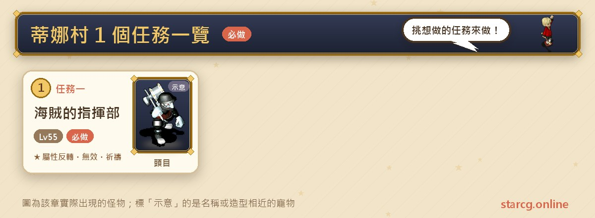
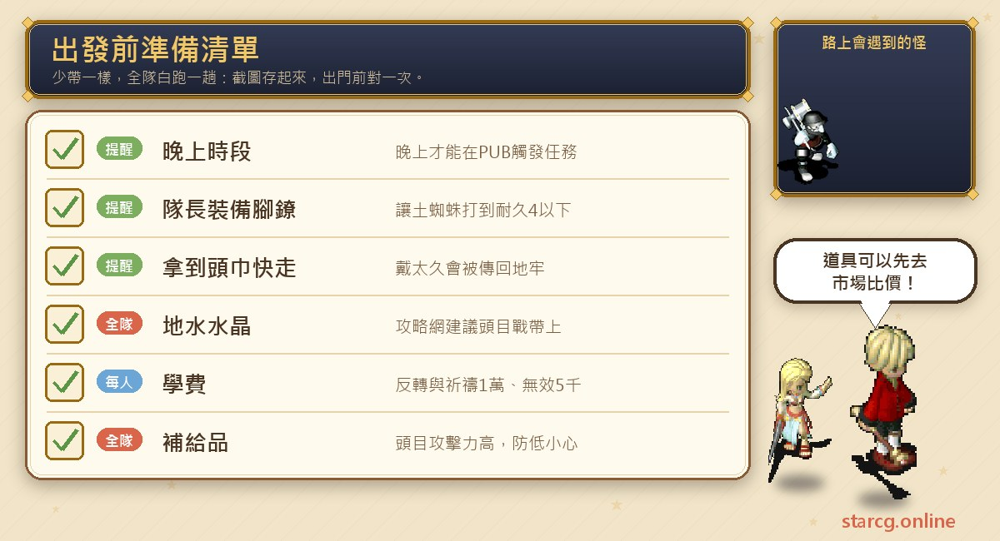
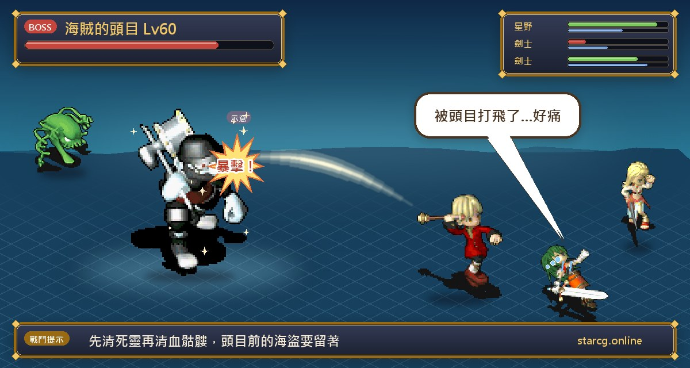
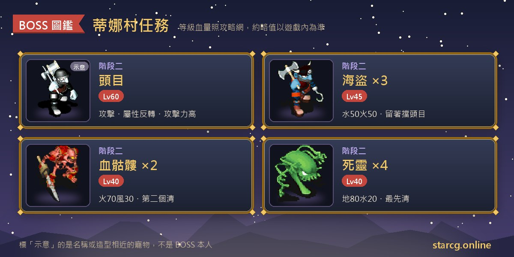

티나 마을(蒂娜村)은 공략 사이트에 지역 퀘스트가 하나만 올라와 있어요. 바로 **해적의 지휘부(海賊的指揮部)**예요. 퀘스트는 밤의 펍(PUB)에서 시작해요. 해적에게 붙잡혀 기지의 지하 감옥에 갇힌 뒤, 「아주 무거운 족쇄」로 간수를 속이고 비린내 나는 두건으로 바꿔 써서 해적들 사이에 섞여 지하 5층부터 올라가고, 마지막에 해적 두목과 한판 붙어요. 이기면 이곳에서 **속성 반전, 공격 무효, 마법 무효**와 **4속성 기도**를 배울 수 있어요. 속성 반전과 기도는 주술사의 스킬이고, 공격 무효와 마법 무효는 무술사의 스킬이라서 이 퀘스트는 두 직업에게 특히 중요해요.

권장 55레벨, 조건은 40레벨이며 밤에 진행해야 해요. 이 글에서는 전체 흐름을 「붙잡힘과 탈출, 두목전, 스킬 배우기」 세 단계로 나눠 정리하고, 가장 실수하기 쉬운 족쇄 내구도와 두건 시간 제한을 따로 표시했어요. StarCG(星詠魔力), 水藍魔力, 初心魔力寶貝 중 무엇을 하든 티나 마을 해적의 지휘부 진행은 같으니 그대로 활용하면 돼요.

> 이 글은 [StarCG 공략 사이트](https://guide.starcg.net/)의 「해적의 지휘부」 퀘스트 페이지와 스킬 페이지를 바탕으로 저희 방식대로 순서를 다시 짜고 새로 쓴 것으로, 원문을 그대로 옮기지 않았어요. 보스 수치는 대략적인 값이니 실제 게임을 기준으로 해 주세요. 공략 사이트에 없는 수치는 모두 「공략 사이트 미기재」로 적었고, 게임 업데이트 후 내용이 바뀔 수 있어요.

## 티나 마을 퀘스트는 무엇인가요? 전체 순서부터

티나 마을의 지역 퀘스트는 해적의 지휘부 하나뿐이지만 진행이 짧지 않아요. 공략 사이트는 이 퀘스트를 **자동 길안내 지원**으로 표시해서 수수께끼 단계까지는 길안내를 따라가면 되고, 그 뒤의 탈출 루트는 직접 걸어야 해요.

| 단계 | 내용 | 권장 레벨 | 획득 |
|---|---|---|---|
| 1단계 | 지하 감옥에 잡혀가 족쇄를 두건으로 바꿔 탈출 | 55 | 아주 무거운 족쇄, 비린내 나는 두건, 쪽지 |
| 2단계 | 두목전 | 55 | 스킬 배우는 방 입장 |
| 3단계 | 스킬 배우기 | — | 속성 반전, 공격 무효/마법 무효, 기도 |

한 줄로 정리하면: **밤에 펍에 가서 잡혀가고, 흙거미에게 족쇄 내구도를 4 이하로 깎인 뒤 절인생선에게 가서 두건으로 바꾸고, 루트대로 한 층씩 술을 바꿔 쪽지를 얻어 올라가 두목을 잡고, 마지막에 직업에 맞는 방을 골라 스킬을 배워요.**

## 출발 전에 이것부터 준비하세요

해적의 지휘부는 재료를 모을 필요가 없고, 준비할 것은 주로 「시간」과 「수강료」예요.

가장 중요한 건 **밤**에만 펍에서 퀘스트가 시작된다는 점이에요. 탈출할 때는 **리더**가 족쇄를 장비하니 리더가 흙거미의 공격을 몇 번 버틸 수 있어야 해요. 두목전에는 공략 사이트가 **지·수 수정(地水水晶)**을 권해요. 스킬을 배우는 데도 돈이 들어요. 속성 반전과 4속성 기도는 각 10,000G, 공격 무효와 마법 무효는 각 5,000G라서 한 번에 다 배우려면 돈을 먼저 준비해 두세요. 보급품과 수정이 부족하면 이 사이트의 [시세 조회](/ko/market/)로 시세를 먼저 확인해 보세요.

## 1단계: 밤에 지하 감옥으로 잡혀가 족쇄를 두건으로 바꿔 탈출

먼저 잡혀 들어가요.

1. 밤 시간대에 티나 마을의 **펍**(46, 56)에 가서 계단 옆의 **해적 코루니(海賊柯魯妮)**와 대화하면 해적 기지의 지하 감옥으로 잡혀가요.
2. 감옥 문밖의 **절인생선(鹹魚)**과 대화하면 「**아주 무거운 족쇄(很重的腳鐐)**」를 받아요.

공략 사이트의 주의: 퀘스트 안 NPC의 위치는 **매일 랜덤**이라서, 사람이 안 보이면 근처를 더 돌아봐야 해요.

이어서 족쇄를 두건으로 바꾸고 한 층씩 위로 탈출해요.

1. **리더**가 아주 무거운 족쇄를 장비하고 전투에 들어가 **흙거미(土蜘蛛)**에게 맞아서 족쇄 내구도를 **4 이하**로 떨어뜨려요.
2. 다시 해적 **절인생선**과 대화하면 족쇄를 바꿔 주는데, 그 틈에 그를 기절시키고 「**비린내 나는 두건(有魚腥味的頭巾)**」을 얻어요.
3. 공략 사이트의 루트대로 올라가며 도중에 해적 세 명과 아이템을 교환해요. (동·서·남·북은 방위, 우·상·하는 화면 기준 오른쪽·위·아래예요.)
   - 지하 5층: 동→동→우→상→우→우→동→상→상→우→남→남→남, 도중에 「**어묵(魚蛋)**」을 찾아 브라운 술(布朗酒)로 교환해요.
   - 지하 4층: 남→우→(전송)→동→동→(전송)→동→동→(전송)→남, 도중에 「**벌레새우(蟲蝦)**」를 찾아 콜리치 술(柯利奇酒)로 교환해요.
   - 지하 3층: 동→(전송)→하→(전송)→우→상→북→(전송)→남→남→남, 도중에 「**게돌이(蟹兒)**」를 찾아 쪽지로 교환해요.
   - 지하 2층: 남→남→서→북→북, **매혹의 상아(魅惑的象牙)**를 건드려 위층으로 가요.
4. 위층에서 **해적 루위크(海賊鱸魚克)**와 대화해 쪽지를 주면 두목의 방에 들어가요.

**주의할 점**:

- 족쇄 내구도가 **4 이상**일 때 절인생선에게 가면 내구도를 15로 되돌려 줄 뿐이라 헛수고예요.
- 비린내 나는 두건을 **너무 오래** 쓰고 있으면 인간 냄새가 들켜 지하 감옥으로 돌려보내져요. 두건을 받으면 중간에 다른 일을 하지 말고 루트를 한 번에 끝내는 게 좋아요.
- 루트의 「(전송)」은 전송 지점이에요. 공략 사이트 원문에는 루트 지도가 따로 있으니 길을 잘못 들었으면 돌아가서 대조해 보세요.

## 2단계: 두목전(사령 먼저, 다음 블러드 스켈레톤)

**두목**과 대화하면 전투에 들어가요. 적 구성은 다음과 같아요.

- 두목: 60레벨, HP는 공략 사이트 미기재, 지 30·수 30·화 30·풍 30, 공격과 **속성 반전**을 써요.
- 해적 ×3: 45레벨, 수 50·화 50.
- 블러드 스켈레톤(血骷髏) ×2: 40레벨, 화 70·풍 30.
- 사령(死靈) ×4: 40레벨, 지 80·수 20.

**공략법**: 공략 사이트가 권하는 순서는 **사령 먼저, 다음 블러드 스켈레톤, 그 뒤 두목 집중 공격**이에요. 두목 앞의 해적은 **남겨 두어야** 두목이 캐릭터를 직접 공격하지 않아요. 두목은 공격력이 매우 높아서 방어가 낮은 캐릭터는 날아가지 않게 조심하세요. 지·수 수정을 챙기는 것도 공략 사이트의 권장이에요.

## 3단계: 스킬 배우기(직업에 맞게 방 선택)

이긴 뒤에는 이렇게 해요.

1. **두목**(19, 10)과 대화하면 **속성 반전**을 배울 수 있고, 비용은 10,000G예요.
2. **보석쥐 무술사 코유(寶石鼠巫師小由)**(16, 6)와 대화해 「예」로 돕겠다고 하고 「확인」을 누른 뒤, 어느 방으로 갈지 골라요.
   - 「예」를 고르면 **방 1**: **화염쥐 무술사 코아이(火焰鼠巫師小愛)**(16, 6)가 **마법 무효**(5,000G)를, **천서(天書)**(22, 9)가 **대지의 기도**, **천서**(22, 12)가 **바다의 기도**(각 10,000G)를 가르쳐요.
   - 「아니요」 다음 「예」를 고르면 **방 2**: **악몽쥐 무술사 코아이(噩夢鼠巫師小愛)**(16, 6)가 **공격 무효**(5,000G)를, **천서**(22, 9)가 **화염의 기도**, **천서**(22, 12)가 **구름의 기도**(각 10,000G)를 가르쳐요.

**스킬 핵심**(공략 사이트 스킬 페이지):

| 스킬 | 비용 | 마력 절반/경험치 2배 직업 | Lv1 효과 | Lv10 |
|---|---|---|---|---|
| 속성 반전 | 10,000G | 주술사 | 마력 20, 지정 대상 2턴 속성 반전 | 상생상극, 마력 65, 7턴 |
| 공격 무효 | 5,000G | 무술사 | 마력 40, 2회 행동 동안 물리 공격 2회 무효 | 힘의 벽, 마력 220 |
| 마법 무효 | 5,000G | 무술사 | 마력 40, 2회 행동 동안 마법 공격 2회 무효 | 마법 장벽, 마력 220 |
| 4속성 기도 | 각 10,000G | 주술사 | 마력 30, 양측 2턴 동안 해당 속성 10마다 피해 1% 감소 | 마력 105, 7턴, 3.5% |

공격 무효와 마법 무효는 효과 중에 회복 마법의 회복량도 올려 줘요(Lv1 2%, Lv10 20%). 4속성 기도의 Lv10 이름은 각각 대지의 사랑, 바다의 마음, 불의 춤, 하늘의 축복이에요.

**주의할 점**: 방 1과 방 2에서 가르치는 스킬이 달라요. 공격 무효와 마법 무효가 서로 다른 방에 있고, 화·지·수·풍 4속성 기도도 두 묶음으로 나뉘어 있어요. 공략 사이트는 한 번 클리어로 두 방에 모두 들어갈 수 있는지 적지 않았으니, 다 배우고 싶다면 방에 들어가기 전에 가장 필요한 묶음이 무엇인지 먼저 정하세요.

## 티나 마을 자주 묻는 질문

**해적의 지휘부는 꼭 밤에 해야 하나요?** 네. 퀘스트 조건이 40레벨·밤이고, 밤에만 펍에서 해적 코루니를 찾아 시작할 수 있어요.

**절인생선이 왜 족쇄만 고쳐 주나요?** 족쇄 내구도를 먼저 4 이하로 깎아야 해요. 4 이상이면 내구도를 15로 되돌려 줄 뿐이에요.

**왜 도중에 지하 감옥으로 돌려보내지나요?** 비린내 나는 두건을 너무 오래 쓰고 있으면 인간이라는 게 들켜 감옥으로 돌려보내져요. 두건을 받으면 최대한 빨리 루트를 끝내세요.

**두목전은 누구부터 잡나요?** 공략 사이트는 사령 먼저, 다음 블러드 스켈레톤, 그 뒤 두목 집중 공격을 권해요. 두목 앞의 해적은 남겨 두어 두목이 캐릭터를 직접 치지 않게 하세요.

**공격 무효와 마법 무효는 어디서 배우나요?** 두목을 이긴 뒤 보석쥐 무술사 코유와 대화해 방을 골라요. 방 1은 마법 무효, 방 2는 공격 무효이며 각 5,000G예요.

## 정리: 전투보다 시간 제한이 더 중요해요

해적의 지휘부에서 정말 막히는 건 두목이 아니라 보이지 않는 두 가지 제한이에요. 족쇄 내구도를 4 이하로 깎아야 하고, 두건을 너무 오래 쓰면 감옥으로 끌려가요. 밤 시간대를 잘 맞추고, 리더가 족쇄를 맡고, 두건을 받으면 루트를 한 번에 끝낸 뒤 두목전은 「사령, 블러드 스켈레톤, 두목」 순서로 처리하면 주술사와 무술사의 중요한 스킬을 무난히 배울 수 있어요.

더 자세한 원문과 루트 지도는 [StarCG 공략 사이트](https://guide.starcg.net/)에서 확인할 수 있어요. 이 사이트의 [펫 도감](/ko/pets/)에서 해적, 블러드 스켈레톤, 사령 같은 몬스터 정보를 보고, [시세 조회](/ko/market/)로 수정과 보급품도 준비해 보세요.
