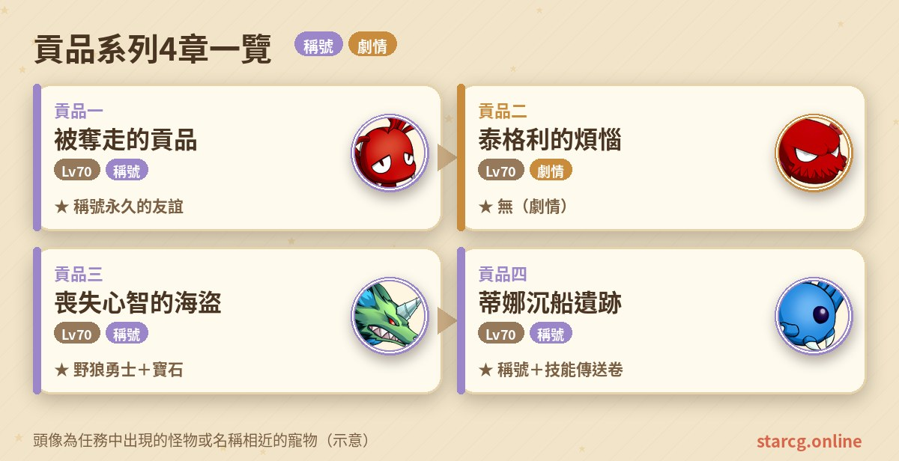
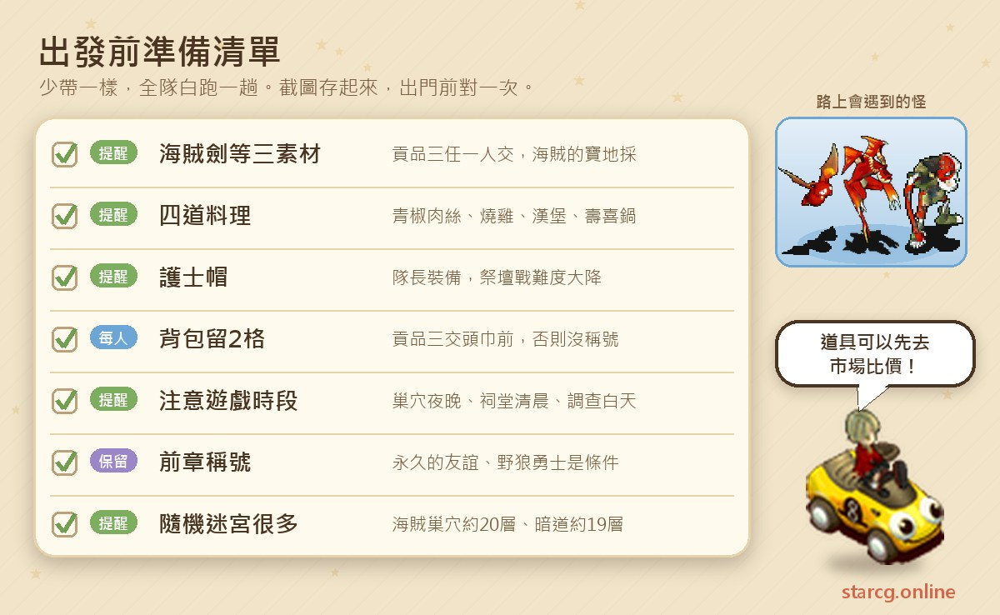
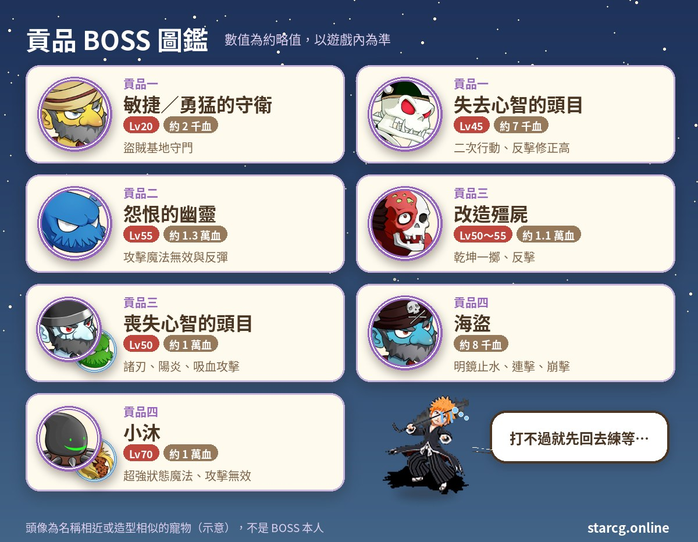
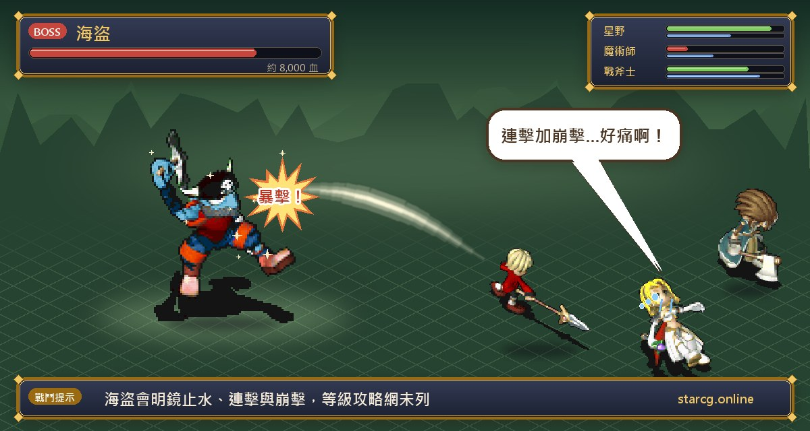

魔力寶貝的貢品系列，是一條圍繞蒂娜村海賊傳說的中等級劇情任務：從法蘭城東門的李林被搶走的貢品開始，你會跟著大偵探漢克一路調查，走過芙蕾亞海賊基地、海賊巢穴、海賊祠堂、蒂娜海底沉船與地獄妖犬巢穴，揭開海賊頭目喪失心智的真相。整個系列共四章，每一章推薦等級都是 70 級，是 70 級前後很適合穿插進行的任務線。

貢品任務最吸引人的是三個**永久稱號**：貢品一的「永久的友誼」、貢品三的「野狼勇士」、貢品四的「揭開真相之人」；貢品三還會一次給寶石、鋼騎之礦、魔族的水晶、火焰之魂、誓言之證等一包材料，貢品四則是隨機技能傳送卷。不論你玩的是星詠魔力、水藍魔力還是初心魔力寶貝，貢品系列的任務流程都是一樣的，這份整理都能直接拿來用。

> 本文整理自 [星詠魔力攻略網](https://guide.starcg.net/) 的貢品系列頁面與「海賊的寶地」頁面，並用我們自己的方式重新排序與改寫，沒有逐字照搬。BOSS 血量與數值是約略值，攻略網有幾處等級前後不一致、屬性欄空白的地方，本文已標註；實際以遊戲內為準，遊戲更新後內容可能變動。

## 貢品系列是什麼？先看整體順序

貢品系列四章是一條直線，每一章的條件都是上一章的稱號或完成紀錄。比較特別的是貢品三：除了要完成貢品二，還要先帶著「海賊的寶地」任務採到的三樣素材，這是整條線最容易漏掉的前置。

| 章節 | 任務名稱 | 推薦等級 | 取得 |
|---|---|---|---|
| 貢品一 | 被奪走的貢品 | 70（無條件） | 永久稱號「永久的友誼」 |
| 貢品二 | 泰格利的煩惱 | 70 | 無（劇情承接，攻略網標示無獎賞） |
| 貢品三 | 喪失心智的海盜 | 70 | 永久稱號「野狼勇士」、寶石與材料一包 |
| 貢品四 | 蒂娜沉船遺跡 | 70 | 永久稱號「揭開真相之人」、隨機技能傳送卷 |

攻略網在貢品一頁面標示支援自動導航，地點不熟的話可以利用。

## 出發前先準備好這些

貢品系列不太需要高價消耗品，準備重點是「時段」和「特定道具」：海賊巢穴要夜晚、海賊祠堂要清晨、貢品二調查樣本要白天；泰格利要四道料理，貢品三要三樣採集素材與兩格背包空位。

貢品二要交給泰格利的青椒肉絲、燒雞、漢堡、壽喜鍋各一份，自己不會料理的話，可以先用本站的 [市場查價](/market/) 搜尋這幾道料理，看看攤位價格再決定要自己做還是直接買。另外，這個系列的隨機迷宮很多：芙蕾亞海賊基地 5 層、海賊巢穴約 20 層、貢品三的暗道約 19 層、貢品四的海盜暗道 5 層，再加上地獄妖犬巢穴，建議搭配本站的 [迷宮找樓梯](/maze/) 邊走邊記錄樓梯位置。

## 貢品一：被奪走的貢品（永久的友誼）

推薦 70 級，沒有任務條件。

1. （劇情，可略過）到法蘭城東門找**李林**（278, 82）對話，選「是」。
2. 到伊爾村外西南方（665, 329）找**傳送石**進入**芙蕾亞海賊基地**。傳送石在村外，不是霞之洞窟。這裡是 5 層的隨機迷宮，魔物是 Lv.5～10 的盜賊與迷你蝙蝠。
3. 抵達盜賊基地，找**守衛**對話開戰。
4. 打贏後繼續往前，找**芙蕾雅盜賊頭目**對話，拿到【海盜水晶】。
5. **夜間**到蒂娜村村長家門口，找**守衛**（27, 59）對話，被傳送到柵欄內，再走傳送石進入**海賊巢穴**。這是約 20 層的隨機迷宮，**迷宮每 2 小時刷新一次**。
6. 在巢穴裡找**喪失心智的頭目**對話開戰。
7. 打贏後再對話，拿到【李林的貢品】。
8. 回法蘭城東門找**李林**（278, 82）交出貢品，獲得稱號，完成。

**BOSS 資料**

- 盜賊基地｜**敏捷的守衛**、**勇猛的守衛**：都是 20 級、約 2,000 血。
- 海賊巢穴｜**失去心智的頭目**：45 級、約 7,000 血，**二次行動**、反擊修正高，會攻擊、防禦、乾坤一擲、諸刃、連擊、陽炎、吸血攻擊。身邊有 9 隻**海賊**（50 級、各約 1,400 血，**不抗毒**，會諸刃、崩擊）。

**要注意的地方**：海賊巢穴只能在夜間從村長家門口的守衛進去，白天去會撲空。頭目反擊修正高，物理輸出打下去容易被反擊；海賊數量多但不抗毒，可以善用中毒類手段。攻略網把盜賊基地寫成「芙蕾亞海賊基地」與「芙蕾雅盜賊基地」兩種寫法，指的是同一個地方。

## 貢品二：泰格利的煩惱（調查、料理與墳墓的幽靈）

推薦 70 級，條件是擁有「永久的友誼」稱號。這章跑腿的地點很多，但流程很直線，照順序走就不會錯。

1. 到法蘭城冒險者旅館 1 樓找**大偵探漢克**（35, 41），拿到水質、土質、植物三種**取樣器**。
2. **白天**到蒂娜村，依序在（28, 49）、（47, 31）、（72, 42）調查並交出對應的取樣器，拿到三種樣本。
3. 回旅館把三種樣本交給漢克，拿到【蒂娜村物質樣本】。
4. 到聖拉魯卡村醫院外找**元素研究者**（35, 46），交出物質樣本，拿到【未知物質樣本】。
5. 到法蘭城謝里雅堡 2 樓圖書館找**元素專家耐羅恩**（28, 23），交出未知物質樣本，拿到【蒂娜村物質報告】。
6. 回旅館把報告交給漢克，拿到【漢克的請求】。
7. 到法蘭城東門找**李林**（278, 82），交出請求，拿到【李林的回覆】。
8. 回旅館把回覆交給漢克，拿到【漢克的託付】。
9. 到蒂娜村外小屋旁找**泰格利**（582, 258），選「是」交出託付，拿到【泰格利的菜單】。
10. 備齊**青椒肉絲、燒雞、漢堡、壽喜鍋**各一份，找泰格利交出料理與菜單，拿到【泰格利的請求】。
11. 到傑諾瓦鎮醫院 2 樓找**除魔師亨特**，交出請求，拿到【聚靈鏡】。
12. **夜晚**到蒂娜村墳墓找**幽靈**（65, 54）開戰。
13. 打贏後**解散隊伍**，調查墳墓（72, 52）並交出聚靈鏡，拿到【泰格利的項鍊】。
14. 回小屋旁把項鍊交給泰格利，拿到【泰格利的報告】。
15. 回旅館把報告交給漢克，完成。

**BOSS 資料**

- **怨恨的幽靈**：55 級、約 13,000 血。會攻擊、防禦、諸刃、乾坤一擲、反擊，還有**攻擊無效、魔法無效、攻擊反彈、魔法反彈**，以及火焰的祈禱、雲群的祈禱。
- **血魔** ×6：60 級、各約 2,500 血，邪魔系、不抗咒、**二次行動**，會冰凍魔法、強力冰凍魔法、火焰魔法。

**要注意的地方**：

- 怨恨的幽靈同時會無效與反彈物理和魔法，打之前要看清楚牠身上是哪一種狀態再出手，不然打下去的傷害可能全彈回自己身上。六隻血魔二次行動、不抗咒，可以考慮先用控制技能壓住。
- 打完幽靈要**先解散隊伍**，才能調查墳墓拿項鍊。
- 已經完成過任務、或丟掉泰格利項鍊的人，可以跟著參加 BOSS 戰，但拿不到後續道具。
## 前置任務：海賊的寶地（貢品三三素材）

貢品三要求持有【海賊劍】、【謝爾席拉的樹枝】、【亞留特獅子的皮】，這三樣都來自「海賊的寶地」任務。這個任務推薦 25 級，條件是伐木、狩獵、挖掘技能都達到 3 級。

1. 到謝歐爾洞窟（699, 197）調查**老舊書架**（42, 24），拿到地圖。
2. 持地圖從謝歐爾洞窟（4, 11）進入另一側，在（27, 36）附近用**挖掘 R3** 採集海賊劍。
3. 到芙蕾雅亞留特域（550, 19）附近用**伐木 R3** 採集謝爾席拉的樹枝；到（621, 33）附近用**狩獵 R3** 採集亞留特獅子的皮。
4. 採到的東西要確認是不是真品：鑑定後保留真品，其餘可以刪除。

攻略網的「海賊的寶地」後續流程（清晨進海盜的祠堂、打野狼船長、選礦工／樵夫／獵人的手環）沒有寫到和貢品系列的關係。對貢品三來說，**重點是把三樣素材留在身上**；而且貢品三在祭壇只需要隊伍中**任一人**交出這三樣，全隊就能一起傳送，不必每個人都採一套。

## 貢品三：喪失心智的海盜（野狼勇士）

推薦 70 級。條件是完成貢品二，並持有海賊劍、謝爾席拉的樹枝、亞留特獅子的皮。這章對時段要求最多：白天、清晨、傍晚到夜晚都有。

1. **白天**到蒂娜村外小屋旁找**泰格利**，選「是」進入海賊巢穴。
2. 在巢穴（24, 8）的書籍選「是」，拿到【貝拉米的日記】。
3. 在（12, 5）的石頭選「是」，拿到【奇怪的符文】，再找泰格利離開巢穴。
4. （可跳過）回冒險者旅館 1 樓，持日記與符文找漢克。
5. 到芙蕾雅島謝歐爾洞窟（699, 197）找**助手**，交出日記，拿到【筆記鑑定信】。
6. 到傑諾瓦鎮醫院 2 樓找**除魔師亨特**，交出符文，拿到【符文解密信】。
7. 回冒險者旅館 1 樓找漢克，交出兩封信，拿到【祭壇調查令】。
8. **清晨**到亞留特村外西方洞穴（549, 43），從（11, 7）的樓梯進入**海賊祠堂**。
9. 調查**祭壇**，隊伍中任一人交出三樣素材，全隊傳送到**海賊洞窟**（固定迷宮）。
10. 穿過洞窟抵達野狼船長靈堂，找**小沐**（35, 39）進入**暗道**。暗道是約 19 層的隨機迷宮，魔物是約 Lv.20 的四屬性蜘蛛。
11. 抵達隱密祭壇，找**米內帕魯**對話開戰。
12. 打贏後找**貝拉米的意志**交出祭壇調查令，拿到【貝拉米的格鬥刀】。
13. （劇情，可省略）回旅館持格鬥刀找漢克。
14. **傍晚到夜晚**回到蒂娜村外小屋旁，找泰格利進入海賊巢穴。
15. 找**喪失心智的海賊**對話，進入最終 BOSS 戰。
16. 打贏後找海賊交出貝拉米的格鬥刀，拿到【海賊頭目的頭巾】。
17. **確認背包有空位**後，回冒險者旅館 1 樓把頭巾交給漢克，獲得稱號與隨機獎品，完成。

**BOSS 資料**

- 祭壇戰｜**改造殭屍**：約 11,000 血，會攻擊、乾坤一擲、反擊；帶 6 隻 45 級、約 1,300 血的殭屍。攻略網同一頁前後分別寫 Lv.55 與 Lv.50，兩處不一致。
- 最終戰｜**喪失心智的頭目**：50 級、約 10,000 血，會攻擊、防禦、諸刃、陽炎、反擊、乾坤一擲、吸血攻擊、崩擊；帶 5 隻 50 級的血骷髏與 4 隻死靈。

**打法與提醒**：攻略網特別提到，祭壇戰如果**隊長裝備「護士帽」**（誘拐事件任務取得），難度會大幅降低，手上有的話記得戴上。最終戰的頭目會反擊與吸血攻擊，小怪數量也多，可以用 [傷害計算機](/damage/) 估一下輸出，先清小怪再集中打頭目。

**最重要的警告**：交出頭巾前，**每位隊員的物品欄至少要留 2 格**，空間不夠會拿不到永久稱號「野狼勇士」，損失很大。獎品內容是寶石（攻略網一處寫 5～8 級、一處寫 Lv.8 各色寶石）、鋼騎之礦 ×2、魔族的水晶 ×2、火焰之魂 ×2、誓言之證 ×2。想重新做這一章的話，要從貢品二開始。

## 貢品四：蒂娜沉船遺跡（揭開真相之人）

推薦 70 級，條件是擁有「野狼勇士」稱號。這章要在海底、海盜暗道與地獄妖犬巢穴之間來回，最後一戰敵人最多。

1. 從蒂娜村南門出村，到莎蓮娜島（591, 331）找**老漁民**，選「是」傳送到**蒂娜海底**。海底的走法是**依地面顏色交替左右前進**。
2. 抵達沉船，找**副手喬治**（27, 23），拿到【黃色三角石】。
3. 到蒂娜村外東方的**樹木**（676, 321）進入**海盜暗道**（5 層隨機迷宮）。
4. 穿過迷宮到暗道底層外部，調查門進入底層內部。
5. 找**海盜**對話開戰。
6. 打贏後找**貝拉米的舵手**，拿到【奇怪的黏稠物】。
7. （劇情，可省略）回冒險者旅館 1 樓找漢克。
8. 到謝里雅堡 2 樓圖書館找**元素專家耐羅恩**，交出黏稠物，拿到【黏稠物成份報告】。
9. （劇情，可省略）回旅館找漢克。
10. 到法蘭城（278, 82）找**李林**，交出成份報告，拿到【綠色三角石】。
11. 到貝茲雷姆神殿外西方的**石柱**（117, 322）調查，進入**地獄妖犬巢穴**。
12. 穿過隨機迷宮到巢穴底層，找**小沐**交出綠色三角石，拿到【火精靈之石】。
13. 回法蘭城（278, 82）找李林，交出火精靈之石，拿到【黏稠物分析報告】。
14. 到旅館找漢克交出分析報告，拿到【隱身斗篷】。
15. 再次從樹木（676, 321）進入海盜暗道，穿過迷宮到底層外部，調查門進入。
16. 調查**櫃子**（24, 16）進入底層內部，找米內帕魯、阿魯巴斯、小沐**任一人**對話開戰。
17. 打贏後找小沐，獲得永久稱號「**揭開真相之人**」。
18. 到法蘭城東門附近找李林，拿到【隨機技能傳送卷】，完成。

**BOSS 資料**

- 海盜暗道｜**海盜**：約 8,000 血（攻略網未列等級），會攻擊、防禦、諸刃、明鏡止水、連擊、崩擊。
- 最終戰｜**小沐**：70 級、約 10,000 血，會超強狀態魔法、超強魔法、**攻擊無效**。同場有迷你蝙蝠、水蜘蛛、史萊姆、蜥蜴戰士各 2 隻（70 級，會諸刃、乾坤、連擊；攻略網未列血量）。

**打法**：攻略網建議先用多人合擊把嘍囉清掉，再用寵物戰慄小沐，持續拖到牠無法行動。小沐有攻擊無效又會超強狀態魔法，八隻嘍囉也都會連擊與乾坤，是整個系列敵人最多的一戰，抗異常的手段要準備好。

## 貢品系列常見問題

**貢品任務要從哪裡開始？** 到法蘭城東門找李林（278, 82）。貢品一沒有任務條件，推薦 70 級。

**海賊巢穴怎麼進去？** 貢品一要在夜間找蒂娜村村長家門口的守衛（27, 59）；貢品三則是找蒂娜村外小屋旁的泰格利進入，第一次白天、第二次傍晚到夜晚。

**貢品三的海賊劍、樹枝、獅子皮去哪裡拿？** 做「海賊的寶地」任務（伐木、狩獵、挖掘 3 級），在謝歐爾洞窟與芙蕾雅亞留特域用 R3 採集。祭壇只要隊伍中任一人交出即可。

**為什麼做完貢品三沒拿到野狼勇士？** 最常見的原因是背包空位不夠。交出頭巾前，每位隊員至少要留 2 格空位。

**貢品三可以重做嗎？** 可以，但要從貢品二開始重新做起。

**貢品二沒有獎勵也要做嗎？** 要。貢品二本身攻略網標示無獎賞，但它是貢品三的條件，不做就接不了後面兩章與兩個稱號。

## 小結：看好時段，留好背包

貢品系列四章都是 70 級推薦，戰鬥強度中等，真正需要注意的是流程細節：海賊巢穴的夜間入口、貢品二的白天調查與四道料理、貢品三的清晨祠堂與海賊的寶地三素材，以及交頭巾前每人兩格背包空位。照順序把這些準備好，三個永久稱號、一包寶石材料和隨機技能傳送卷就能順利入手。

想看更完整的原文，可以到 [星詠魔力攻略網](https://guide.starcg.net/) 查詢貢品系列與海賊的寶地各頁；也歡迎用本站的 [市場查價](/market/)、[迷宮找樓梯](/maze/) 與 [傷害計算機](/damage/)，把整趟貢品任務安排得更順。
