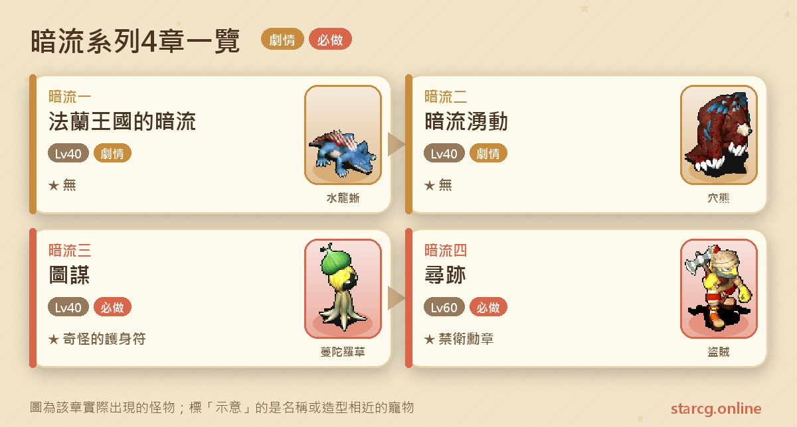
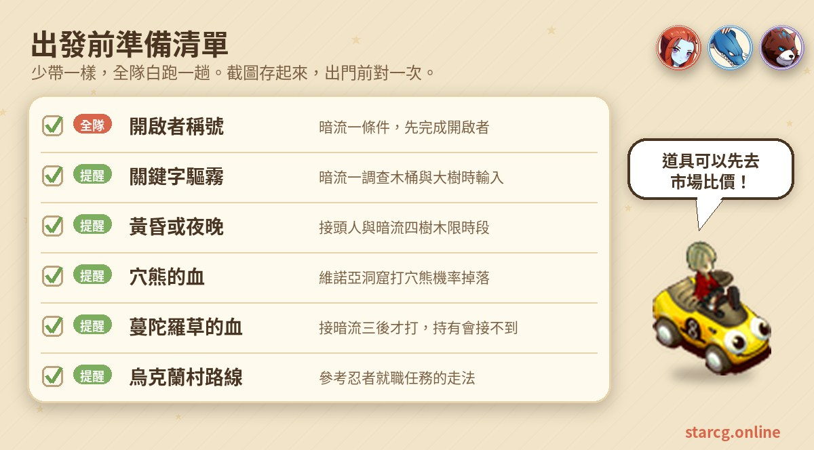
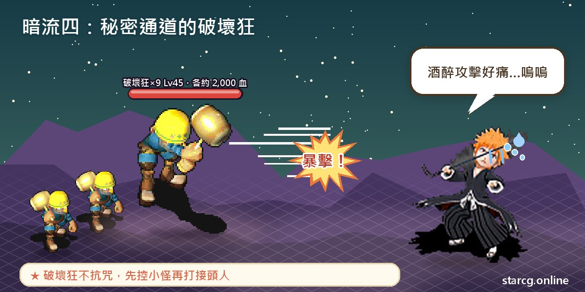
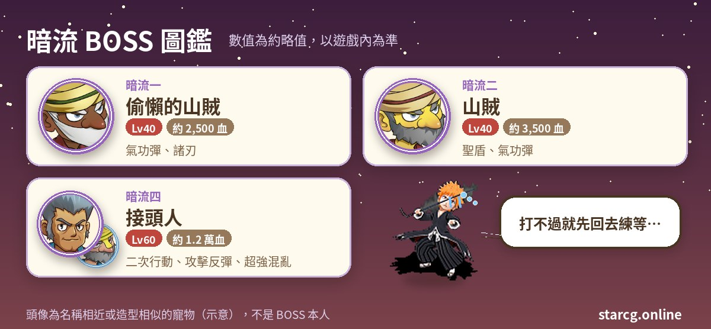

魔力寶貝的暗流系列，是一條以法蘭王國內部陰謀為題材的偵查型劇情任務：謝里雅堡 2 樓的王室安全顧問交給你一份協查通告，你要在烏克蘭村、維諾亞村、聖拉魯卡村與傑諾瓦鎮之間追查線索，假扮成對方的同夥取得信任，最後潛入秘密通道，拿到整個組織的成員名冊。整個系列共四章，前三章推薦 40 級，最後一章推薦 60 級。

暗流任務的戰鬥不多，大部分時間在跑腿、對暗號與蒐集道具，前兩章甚至沒有獎勵，真正的收穫在後兩章：暗流三的**奇怪的護身符**（Lv.3，攻擊 +26），以及暗流四的**禁衛勳章**（Lv.3 護身符，生命 +194～+233）。不論你玩的是星詠魔力、水藍魔力還是初心魔力寶貝，暗流系列的任務流程都是一樣的，這份整理都能直接拿來用。

> 本文整理自 [星詠魔力攻略網](https://guide.starcg.net/) 的暗流系列頁面，並用我們自己的方式重新排序與改寫，沒有逐字照搬。BOSS 血量與數值是約略值，實際以遊戲內為準；遊戲更新後內容可能變動。

## 暗流系列是什麼？先看整體順序

暗流系列一共四章，每一章的條件都是完成上一章。整條線的關鍵人物有兩位：一位是謝里雅堡 2 樓的**王室安全顧問**（52, 23），幾乎每一章都從他開始、也在他這裡結束；另一位是維諾亞村外東邊山背後的**接頭人**（381, 483），從暗流二開始你會反覆在**黃昏或夜晚**去找他。

| 章節 | 任務名稱 | 推薦等級 | 取得 |
|---|---|---|---|
| 暗流一 | 法蘭王國的暗流 | 40（條件：開啟者稱號） | 無 |
| 暗流二 | 暗流湧動 | 40 | 無 |
| 暗流三 | 圖謀 | 40 | 奇怪的護身符 |
| 暗流四 | 尋跡 | 60 | 禁衛勳章 |

要注意的是，暗流一雖然只推薦 40 級，但條件是擁有「**開啟者**」稱號，沒有這個稱號就接不了任務。攻略網在暗流一頁面也標示支援自動導航。

## 出發前先準備好這些

暗流系列需要的東西不多，但很多步驟有「時段」或「關鍵字」限制，記不清楚就會在 NPC 面前白站。下面這張清單把最容易忘記的地方整理在一起。

暗流系列的戰鬥只有三場，消耗不大，帶基本的補血與補魔就夠用；暗流四的接頭人比較硬，等級 60 前後的隊伍可以多帶一些料理與藥水，出發前用本站的 [市場查價](/market/) 比一下價格再買齊。另外，烏克蘭村的走法要參考「忍者就職任務」，第一次去的人建議先查好路線。

## 暗流一：法蘭王國的暗流（驅霧的暗號）

推薦 40 級，條件是擁有「開啟者」稱號（可參考「開啟者」任務）。

1. 到法蘭城謝里雅堡 2 樓，找**王室安全顧問**（52, 23）對話，選「是」，拿到【協查通告】。
2. 到**烏克蘭村**，調查村長家門口的**木桶**（70, 31），**輸入「驅霧」**取得情報。烏克蘭村的走法見「忍者就職任務」。
3. 到**維諾亞村**，調查村內靠近出口的**大樹**（66, 45），同樣**輸入「驅霧」**取得情報。
4. 從維諾亞村出發，到芙蕾雅島（299, 538）進入**維諾亞海底洞窟**。這是固定地圖，共 3 層，魔物是 Lv.26～27 的水龍蜥與蜥蜴戰士。
5. 在洞窟裡找**偷懶的山賊**（250, 490）對話開戰。
6. 打贏後再和偷懶的山賊對話，場景會切換。
7. 找**法蘭禁衛隊長**（17, 27），交出協查通告，拿到【犯人的口供】。
8. 回謝里雅堡 2 樓找王室安全顧問（52, 23），交出犯人的口供，完成。

**BOSS 資料**：**偷懶的山賊**，40 級、約 2,500 血，會攻擊、防禦、氣功彈、諸刃。以推薦等級來說不算難打，正常組隊就能處理。

**要注意的地方**：木桶和大樹都要**輸入關鍵字「驅霧」**才會給情報，直接調查不會有反應。這一章攻略網標示沒有任務獎賞，但它是後面三章的起點，一定要完成。

## 暗流二：暗流湧動（假扮衛兵的準備）

推薦 40 級，條件是完成暗流一。這章來回的地點比較多，中間還要打怪蒐集掉落物。

1. 到謝里雅堡 2 樓找**法蘭禁衛隊長**（52, 26），拿到【惡臭的液體】。
2. 到靈堂下方的地下牢房（7, 52），找**被俘的山賊**（15, 14），交出惡臭的液體，拿到【犯人的新口供】。
3. 回謝里雅堡 2 樓找法蘭禁衛隊長（52, 26），交出犯人的新口供。
4. 到法蘭城旅館（106, 38）2 樓，調查**袋子**（9, 4），選擇進入戰鬥。如果沒辦法觸發戰鬥，攻略網建議**換線**再試。
5. 打贏後找**形跡可疑的人**（8, 4）對話，拿到【接頭信物】。
6. **黃昏或夜晚**到維諾亞村外東邊山背後（381, 483），找**接頭人**，交出接頭信物。
7. 回謝里雅堡 2 樓找**王室安全顧問**（52, 23），拿到【衛兵服】。
8. 到**維諾亞洞窟**打倒**穴熊**，有機率掉落【穴熊的血】。
9. 使用衛兵服，交出穴熊的血與衛兵服，換成【「染血」的衛兵服】。
10. **黃昏或夜晚**再到維諾亞村外東邊山背後（381, 483）找接頭人，交出「染血」的衛兵服，完成。

**BOSS 資料**：旅館袋子觸發的**山賊**，40 級、約 3,500 血，會攻擊、防禦、聖盾、氣功彈。

**要注意的地方**：

- 旅館的袋子偶爾觸發不了戰鬥，換線是攻略網給的解法。
- 穴熊的血是**機率掉落**，可能要多打幾隻穴熊；拿到之後記得先使用衛兵服把兩樣東西合成，才算拿到「染血」的衛兵服。
- 接頭人**只在黃昏或夜晚**會回應，白天去要等時間。這一章同樣標示沒有任務獎賞。

## 暗流三：圖謀（毒藥與奇怪的護身符）

推薦 40 級，條件是完成暗流二。這章完全沒有 BOSS 戰，重點是在幾個 NPC 之間傳遞材料清單，以及打一株蔓陀羅草。

1. **黃昏或夜晚**到維諾亞村外東邊山背後（381, 483）找**接頭人**，拿到【給梅茲的聯絡信】。**身上有【蔓陀羅草的血】的話接不了**，要先丟掉。
2. 到烏克蘭村村長家（69, 28）的地下室找**梅茲**（11, 11），交出聯絡信，拿到【需求材料清單】。
3. 到謝里雅堡 2 樓找**王室安全顧問**（52, 23），拿到【附加批註的材料清單】。
4. 到聖拉魯卡村醫院（37, 50）找**藥劑師辛德**（11, 13），拿到【辛德的回執信】。
5. 回謝里雅堡 2 樓交給王室安全顧問，拿到【逆香花】。
6. 到**傑諾瓦鎮外**打倒**蔓陀羅草**，隨機拿到【蔓陀羅草的血】。
7. 回烏克蘭村長家地下室，把蔓陀羅草的血與逆香花交給梅茲，拿到【「殺人」用的毒】。
8. **黃昏或夜晚**回到維諾亞東邊山背後找接頭人，交出毒藥，拿到【奇怪的護身符】，完成。

**要注意的地方**：

- 第 1 步有個陷阱：如果你為了省時間**先去打了蔓陀羅草的血**，反而會接不到任務。正確順序是先找接頭人拿聯絡信，之後再去傑諾瓦鎮外打蔓陀羅草。
- 蔓陀羅草的血是隨機取得，可能要多打幾隻。

**奇怪的護身符**：Lv.3、耐久 150，攻擊 +26、防禦 -28、敏捷 +5、抗昏睡 +10、閃躲 -2、魅力 -5，**不可交易、不可存入銀行**。這是一件攻擊很高、防禦扣很多的護身符，取捨要看角色定位；裝上之後實際傷害能提升多少，可以用本站的 [傷害計算機](/damage/) 試算比較。

## 暗流四：尋跡（秘密通道與禁衛勳章）

推薦 60 級，條件是完成暗流三。這是系列裡唯一需要走隨機迷宮、也是唯一有難度的一章。

1. 到謝里雅堡 2 樓找**王室安全顧問**（52, 23），拿到【迷彩麻布】。
2. **黃昏或夜晚**到維諾亞村外（373, 489）調查**樹木**，選「是」交出迷彩麻布，傳送到隱密之路，再走**黃色傳送石**（45, 39）進入**秘密通道**。
3. 秘密通道是約 **12～16 層的隨機迷宮**，魔物是 Lv.38～54 的盜賊與破壞狂。穿過迷宮抵達藏身處。
4. 找**接頭人**（11, 5）對話開戰。
5. 打贏後調查**名冊**（11, 12），選「是」拿到【成員名冊】。
6. 回謝里雅堡 2 樓把成員名冊交給王室安全顧問（52, 23），拿到【禁衛勳章】，完成。

**BOSS 資料**

- **接頭人**：60 級、約 12,000 血，**二次行動**，會普通攻擊、防禦、陽炎、**攻擊反彈**、強力冰凍魔法、強力風刃魔法、**超強混亂魔法**。
- **破壞狂** ×9：45 級、各約 2,000 血，地 50／水 50，邪魔系、**不抗咒**、二次行動，會諸刃與醉酒攻擊。

**打法**：接頭人會攻擊反彈，物理職業打下去要留意被反彈的傷害；超強混亂魔法也會打亂隊伍節奏，準備好解混亂的手段比較安心。九隻破壞狂數量多又二次行動，但**不抗咒**，可以利用控制類魔法先壓住小怪，再集中處理接頭人。秘密通道每次結構都不一樣，搭配本站的 [迷宮找樓梯](/maze/) 邊走邊記錄樓梯位置，可以省下不少時間。

**禁衛勳章**：攻略網標示為 3 級飾物（護身符），防禦 +45～+54、精神 +5～+8、生命 +194～+233、耐久 250，另附「攻擊吸收耗魔減少 50%」（攻略網原文寫法）。任務表的獎賞欄寫作「禁衛勛章」，與說明中的「勳章」字形不同，指的是同一件道具。

## 暗流系列常見問題

**暗流任務的前置條件是什麼？** 暗流一要擁有「開啟者」稱號；之後每一章的條件都是完成上一章。

**接頭人為什麼不理我？** 維諾亞村外東邊山背後（381, 483）的接頭人只在**黃昏或夜晚**對話有效；暗流四調查樹木（373, 489）也一樣有時段限制。

**暗流三接不到任務怎麼辦？** 檢查身上是不是已經有【蔓陀羅草的血】。持有這個道具會無法接取，要先丟掉，接到聯絡信之後再去打。

**旅館的袋子調查了沒反應？** 攻略網的建議是換線再試。

**暗流一、二沒有獎勵，可以跳過嗎？** 不行。暗流系列每一章都以完成上一章為條件，想拿奇怪的護身符與禁衛勳章，就要從暗流一開始做起。

## 小結：記好時段與暗號，戰鬥集中在最後一章

暗流系列四章流程不長，戰鬥只有暗流一的偷懶的山賊、暗流二的山賊與暗流四的接頭人三場，真正容易卡住的是細節：「驅霧」關鍵字、接頭人只在黃昏或夜晚出現、穴熊與蔓陀羅草的血要靠機率、暗流三接任務前不能先拿蔓陀羅草的血。把這幾點記住，前三章 40 級就能輕鬆走完，等到 60 級再挑戰暗流四的秘密通道與接頭人，拿下禁衛勳章。

想看更完整的原文，可以到 [星詠魔力攻略網](https://guide.starcg.net/) 查詢暗流系列各頁；也歡迎用本站的 [市場查價](/market/)、[迷宮找樓梯](/maze/) 與 [傷害計算機](/damage/)，把整趟暗流任務安排得更順。
