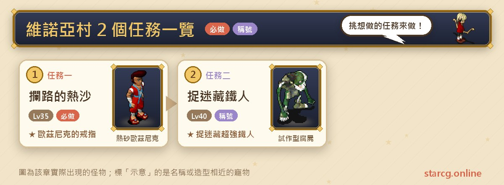
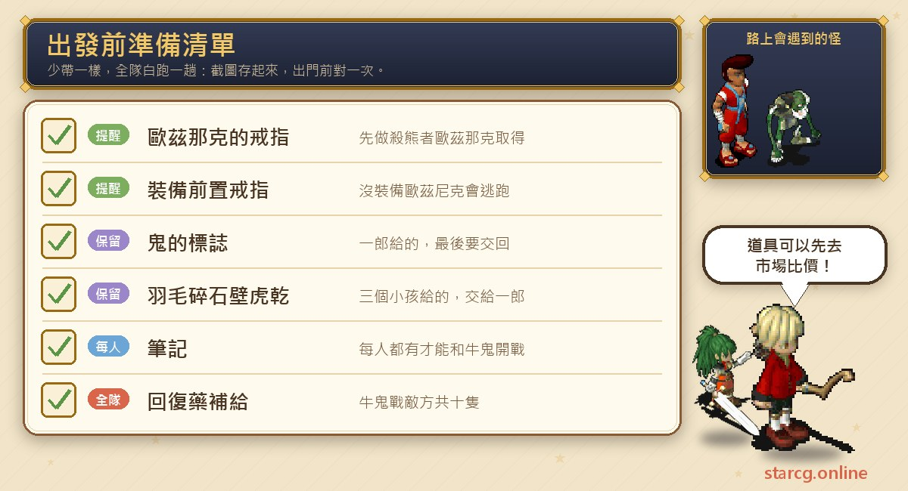
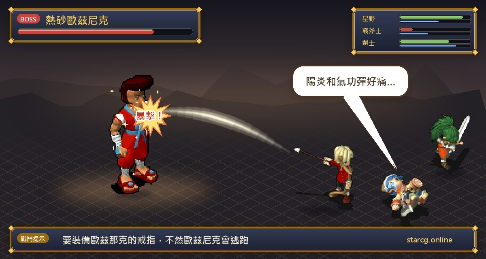
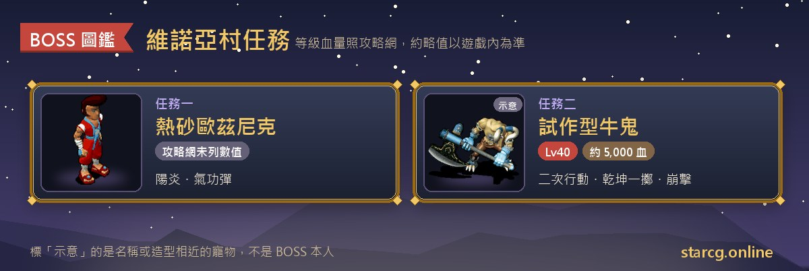

維諾亞村在攻略網上只列了兩個任務，但兩個都和村子周邊的地形綁在一起：「攔路的熱沙」守在村子右上方的海底洞窟，打倒攔路的熱砂歐茲尼克才能拿到戒指、穿過洞窟到索奇亞島；「捉迷藏鐵人」則從一群躲貓貓的小孩開始，最後一路走進怪醫生家地下的黑暗醫生的洞窟，和試作型牛鬼打一場。兩個任務的推薦等級分別是 35 級與 40 級，適合剛離開新手區、準備往索奇亞一帶發展的隊伍。

這篇把兩個任務的條件、步驟、NPC 與座標、戰鬥資料和獎勵整理在一起，並把最容易做白工的地方——沒裝備前置戒指、身上少了筆記——特別標出來。不論你玩的是星詠魔力、水藍魔力還是初心魔力寶貝，維諾亞村任務的流程都一樣，這份整理都能直接拿來用。

> 本文整理自 [星詠魔力攻略網](https://guide.starcg.net/) 的維諾亞村任務頁面（以及攔路的熱沙前置任務「殺熊者歐茲那克」），並用我們自己的方式重新排序與改寫，沒有逐字照搬。BOSS 血量與數值是約略值，實際以遊戲內為準；攻略網沒有列出的數值，本文一律寫「攻略網未列出」，遊戲更新後內容可能變動。

## 維諾亞村任務是什麼？先看整體順序

兩個任務彼此沒有前後關係，可以分開做。真正要注意的是攔路的熱沙有一個「隱藏前置」：必須先在伊爾村那邊完成「殺熊者歐茲那克」，拿到歐茲那克的戒指並裝備著去，歐茲尼克才會乖乖跟你打。

| 任務 | 任務名稱 | 推薦等級 | 取得 |
|---|---|---|---|
| 任務一 | 攔路的熱沙 | 35 | 聲望 500、歐茲尼克的戒指 |
| 任務二 | 捉迷藏鐵人 | 40 | 鬼的標記、稱號「捉迷藏超強鐵人」 |

整理成一句話：**想要歐茲尼克的戒指就先做殺熊者歐茲那克；只想要聲望的話，跟著持有歐茲尼克的戒指的人通過海底洞窟就好。捉迷藏鐵人則是白天接、晚上進洞、白天交，一天之內的時段要抓準。**

條件等級方面，攔路的熱沙的任務頁寫「無」，但攻略網的所有任務總表把兩個任務的限制都寫成 20 級；捉迷藏鐵人的任務頁也寫 20 級。保守起見，建議至少 20 級再來。

## 出發前先準備好這些

維諾亞村的兩個任務都不用買什麼昂貴材料，但「身上要帶著什麼」的規則很嚴格，少一樣就會白跑。

攔路的熱沙最重要的是**歐茲那克的戒指**，要先完成殺熊者歐茲那克取得，並在打歐茲尼克時裝備著。捉迷藏鐵人則要依序收集**鳥的羽毛、黑色的碎石頭、壁虎乾、筆記**，加上一開始拿到的**鬼的標誌**，進怪醫生的家時要持有這些物品，最後也要全部交回給一郎。和試作型牛鬼開戰時，攻略網特別註明**每個人身上都必須有筆記**。補給品方面，牛鬼那一戰敵方多達十隻，腐屍還會自爆，回復藥可以多帶一些；需要補貨時可以先用本站的 [市場查價](/market/) 看看行情。

## 任務一：攔路的熱沙（裝備歐茲那克的戒指再出發）

推薦 35 級，任務頁的條件寫「無」。獎勵是聲望 500 與**歐茲尼克的戒指**。

**前置：殺熊者歐茲那克**。這是伊爾村的任務，推薦 20 級。從法蘭城東門出去，經過往伊爾村的橋（557, 233），進入哈巴魯東邊洞窟（670, 223），下到 2 樓（17, 18）與**殺熊者歐茲那克**對決。攻略網記載他會用崩擊、乾坤一擲、明鏡止水，估計血量約 1,500，旁邊還有 9 隻會諸刃、崩擊的熊。打贏後，隊伍中有一人會拿到「歐茲那克的戒指」。

拿到前置戒指後，正式步驟如下：

1. 裝備**歐茲那克的戒指**。攻略網註明沒有裝備的話，**歐茲尼克會逃跑**。
2. 前往維諾亞村右上方的**海底洞窟**（343, 497），到地下二樓遇敵，有一定機率遇到**熱砂歐茲尼克**。
3. 打倒他之後，取得**歐茲尼克的戒指**。
4. 拿著戒指和海底洞窟裡看門的人交談，就能通過洞窟，抵達**索奇亞島**。

**只想要聲望的話**：攻略網提到，只要隊伍由持有歐茲尼克的戒指的人帶隊通過海底洞窟就可以，不必打歐茲尼克。

**BOSS 資料**：熱砂歐茲尼克的等級與血量攻略網未列出。任務頁的提醒是建議組隊，並用合擊避免**陽炎與氣功彈**，可見這兩招是他的主要威脅。

**要注意的地方**：歐茲那克的戒指在前置任務裡只有隊伍中一人會拿到；攻略網沒有寫是不是全隊每個人都要裝備，只寫了「必須裝備，否則歐茲尼克會逃跑」，所以想拿戒指的人最好各自先完成前置。另外，攻略網的裝備頁說明歐茲尼克的戒指是 4 級飾物、耐久 150～200，用途是「首次前往奇利村的必須品」，本身沒有列出能力加成，主要價值在通行。

**劇情小彩蛋**：殺熊者歐茲那克的床底有一個隱藏小房間，裡面三本日記交代了他和熊的過去。攻略網的劇情推理把幾段線索串在一起：海底洞窟的看守人說歐茲尼克攔路是為了找弟弟妹妹，歐茲那克的日記提到離家出走的哥哥，而在奇利村的誘拐任務中，裝備其中一枚戒指和米內魯帕的父親對話，他會認出那是離家兒子的戒指。攻略網的推論是：歐茲尼克是哥哥、歐茲那克是弟弟、米內魯帕是妹妹。

## 任務二：捉迷藏鐵人（白天接、晚上進洞）

推薦 40 級，條件 20 級。獎勵是**鬼的標記**，裝備後得到稱號「捉迷藏超強鐵人」。攻略網建議**太陽快下山的時候**開始做，因為接任務要白天、進怪醫生的家要晚上。

1. 白天到維諾亞村找**一郎**（47, 52）說話，拿到**鬼的標誌**，裝備後他會要你找出四個躲起來的小孩。
2. 到醫院旁找**忽達巴**（61, 51）說話，拿到**鳥的羽毛**。
3. 到村長的家後面找**小白**（45, 32）說話，拿到**黑色的碎石頭**。
4. 到村子右下角的樹下找**阿三**（37, 68）說話，拿到**壁虎乾**。
5. 第四個小孩找不到，回去和**一郎**說話，拿到**筆記**，他會叫你去找根薩斯。
6. 晚上進入村子左下角的**怪醫生的家**，對後面的玄關（25, 45）說話就能進屋。必須持有前面拿到的物品才進得去。
7. 從屋內右下角的樓梯往下，進入**黑暗醫生的洞窟**，穿過迷宮到最底層，進入黃色傳送點，抵達**黑暗醫生的研究所**。
8. 在研究所找到頭目**試作型牛鬼**開戰。**每個人身上都要有筆記**才會發生戰鬥。
9. 打贏後，到樓梯旁右邊牆壁（27, 14）的小通道裡找**密醫希巴**（40, 23），拿到**黑暗醫學指導書**。
10. 從樓梯（23, 6）出去，白天找**一郎**，交出鳥的羽毛、壁虎乾、黑色的碎石頭、鬼的標誌與黑暗醫學指導書，換到一個「沒有用的東西」。
11. 鑑定後變成**鬼的標記**，裝備即可得到稱號「捉迷藏超強鐵人」。

**BOSS 資料**：

- 試作型牛鬼：40 級、約 5,000 血，地 60 水 40，邪魔系，二次行動，會攻擊、防禦、崩擊、乾坤一擲、明鏡止水。
- 試作型腐屍 ×4：28～30 級、約 900 血，地 60 水 40，不死系，二次行動，會酒醉攻擊與自爆。
- 殭屍 ×5：24～26 級，血量攻略網未列出，地 50 風 50，不死系，會吸血攻擊。

**打法**：敵方一共十隻，腐屍會自爆、殭屍會吸血，牛鬼本身又是二次行動加乾坤一擲。攻略網沒有給這場的具體打法，整理起來的重點是：小怪數量多、腐屍會自爆，範圍輸出與補血都要準備好，不要讓整隊在牛鬼的乾坤一擲和小怪的圍攻下同時掉血。

**要注意的地方**：怪醫生的家、玄關（25, 45）與黑暗醫生的洞窟，和八卦系列的八卦二是同一個地方，做過 [八卦任務](/posts/bagua-quest-guide/) 的玩家會很熟悉。洞窟是隨機迷宮，可以用本站的 [迷宮找樓梯](/maze/) 邊走邊記。另外攻略網的寫法有一點不一致：任務一開始拿到的是「鬼的標誌」，最後鑑定出來的是「鬼的標記」；裝備頁則把「鬼的標誌」列為本任務獎勵，寫的是 4 級飾物、必殺 +1～+3、耐久 150～180。實際名稱與能力請以遊戲內為準。

## 維諾亞村任務常見問題

**為什麼我遇到歐茲尼克，他卻跑掉了？** 攻略網註明要裝備「歐茲那克的戒指」，否則歐茲尼克會逃跑。這枚戒指要先在伊爾村的殺熊者歐茲那克任務取得。

**不打歐茲尼克也能通過海底洞窟嗎？** 可以。只要由持有歐茲尼克的戒指的人帶隊通過，就能拿到聲望。

**歐茲尼克的戒指有什麼用？** 攻略網裝備頁的說明是「首次前往奇利村的必須品」，是 4 級飾物，沒有列出能力加成。

**捉迷藏鐵人為什麼打不到試作型牛鬼？** 每個人身上都必須有一郎給的「筆記」才會發生戰鬥；另外進怪醫生的家要晚上，而且要持有前面收集的物品。

**捉迷藏鐵人要在什麼時段做？** 找一郎接任務與交任務都要白天，進怪醫生的家要晚上，所以攻略網建議太陽快下山時開始。

## 小結：先補前置，再抓時段

維諾亞村的兩個任務都不長，卡關點也很明確：攔路的熱沙卡在「有沒有先做殺熊者歐茲那克、有沒有裝備戒指」，捉迷藏鐵人卡在「白天、晚上、白天」的時段切換與每人一本的筆記。把前置戒指準備好、筆記確認人手一本，再帶夠補給應付十隻敵人的牛鬼戰，就能少跑很多冤枉路。

想看更完整的原文與其他任務，可以到 [星詠魔力攻略網](https://guide.starcg.net/) 查詢；也可以用本站的 [迷宮找樓梯](/maze/) 走黑暗醫生的洞窟，用 [市場查價](/market/) 補齊回復藥。
