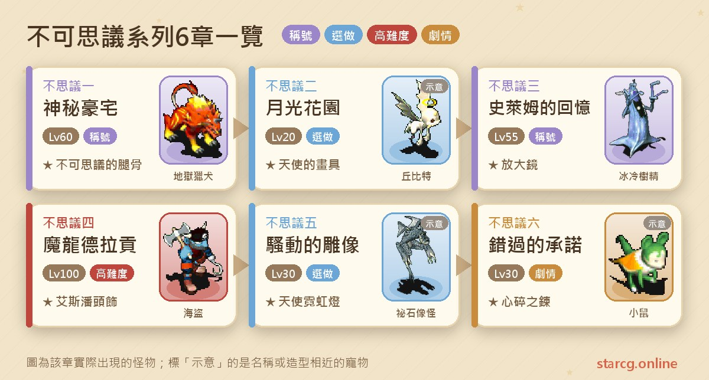
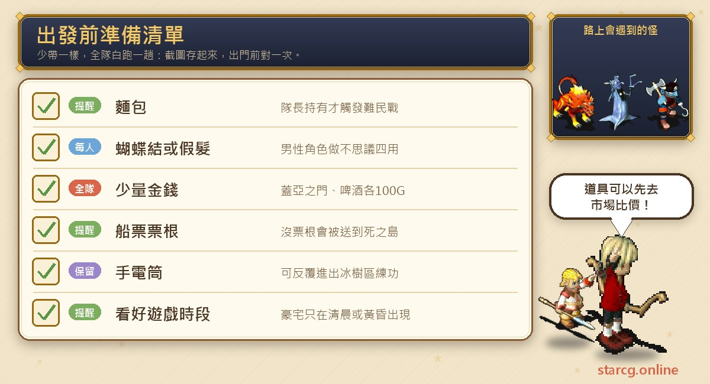
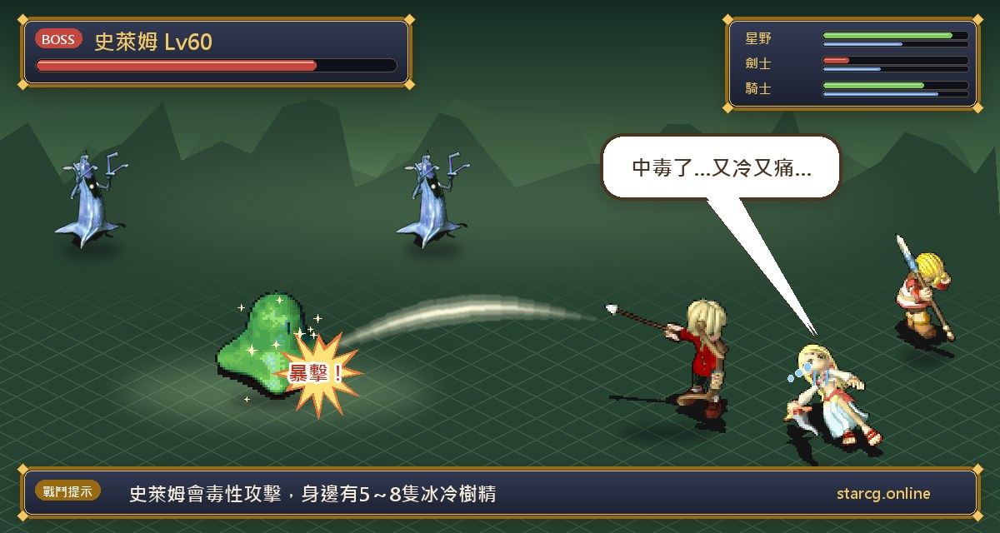
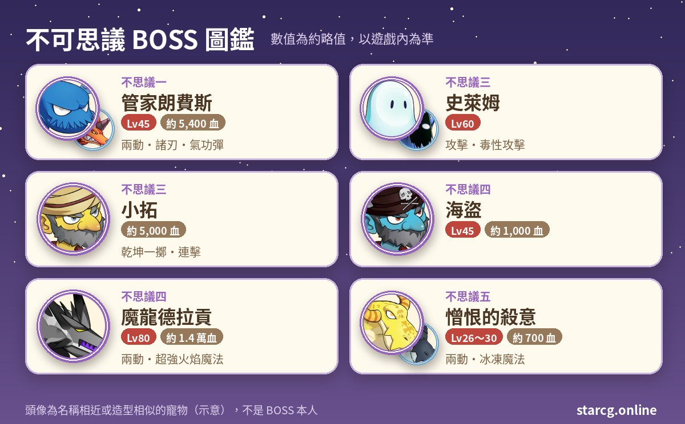

魔力寶貝的不可思議系列，是以亞諾曼城為中心展開的六個小故事：鬧鬼的神秘豪宅、只在月光下開放的花園、躲在冰封酒窖裡的史萊姆、沉睡在沉封之窟的魔龍德拉貢、會在夜裡騷動的雕像，還有一段「錯過的承諾」。和半山這種一路串到底的系列不同，不可思議六章**都沒有任務條件**，彼此也不互相卡關，可以依照自己的等級挑著做。

推薦等級落差很大：不思議二只要 20 級，不思議五、六是 30 級，不思議三、一分別是 55 級與 60 級，最難的不思議四則推薦 100 級。每一章完成都會拿到寵物銀幣（鎖定）×2，加上各自的飾品與稱號，例如「我是小女孩」、「幻影穿梭者」、「急凍魔人」、「收不到訊號」、「分離的戀人」與「心碎之戀」。不論你玩的是星詠魔力、水藍魔力還是初心魔力寶貝，不可思議任務的流程都一樣，這份整理可以直接對照著跑。

> 本文整理自 [星詠魔力攻略網](https://guide.starcg.net/) 的不可思議系列頁面，並用我們自己的方式重新排序與改寫，沒有逐字照搬。BOSS 血量與數值是約略值，實際以遊戲內為準；遊戲更新後內容可能變動。

## 不可思議系列是什麼？先看整體順序

不可思議系列共六章，全部從亞諾曼城出發。因為沒有前置條件，建議的做法是**依推薦等級由低到高**：先做不思議二（20 級），再做不思議五、六（30 級），接著不思議三（55 級）與不思議一（60 級），最後才挑戰不思議四（100 級）。

唯一的小連動是：不思議四的第一步，男性角色需要戴假髮或「蝴蝶結」才能和裘尼拿到地圖碎片，而蝴蝶結正好是不思議一豪宅裡順手能拿到的東西。所以男性角色先做不思議一，可以省下買假髮的錢。

| 章節 | 任務名稱 | 推薦等級 | 取得 |
|---|---|---|---|
| 不思議一 | 神秘豪宅 | 60 | 聲望 200、不可思議的腿骨、稱號「幻影穿梭者」 |
| 不思議二 | 月光花園 | 20 | 聲望 100、天使的畫具 |
| 不思議三 | 史萊姆的回憶 | 55 | 聲望 300、放大鏡、稱號「急凍魔人」（機率） |
| 不思議四 | 魔龍德拉貢 | 100 | 聲望 300、艾斯潘頭飾、稱號「分離的戀人」「收不到訊號」 |
| 不思議五 | 騷動的雕像 | 30 | 天使霓虹燈 |
| 不思議六 | 錯過的承諾 | 30 | 聲望 100、心碎之鍊、稱號「心碎之戀」 |

以上每一章另外都會給寵物銀幣（鎖定）×2。

## 出發前先準備好這些

不可思議系列的戰鬥不多，真正會讓人白跑的是**時段限制、要解散隊伍的步驟，以及少帶一樣小道具**。豪宅只在清晨或黃昏出現、浩克只在白天出現、騷動的雕像要依時段裝不同水量，出發前先看一下遊戲內時間會省很多事。

要花錢的地方不多：不思議二的蓋亞之門 100G、不思議四的啤酒 100G（猜拳輸了要重買）。不思議一需要隊長身上帶一個麵包；男性角色若沒做過不思議一，要在比利啤酒屋外的 COSPLAY 商人買假髮。比較值得留意的是不思議三拿到的手電筒，只要帶著就能反覆進出冰樹區，想在那裡練功的人別丟。若想先估算各項道具的行情，可以用本站的 [市場查價](/market/) 輸入名稱查目前攤位價格。

## 不思議一：神秘豪宅（蝴蝶結與幻影穿梭者）

無任務條件，推薦 60 級。這章步驟多、又有時段限制，是整個系列最需要看時間的一章。

1. （劇情，可省略）帶一個麵包到亞諾曼城（149, 130）找**浩克**對話，會得到提示。
2. 出亞諾曼城東門，往西北沿小路走到（294, 283），與**飢餓的難民**對話開戰，對手是 4～6 級的盜賊。**隊長身上要有麵包**才會觸發。
3. 戰後進入難民村，找**村長**（60, 48）拿「食物袋」，再到村內西北方找**德德**（44, 28）對話，進入漩渦之道。這一步要**解散隊伍**；使用食物袋可以得到「受祝福的火焰鼠腿骨」。
4. 在漩渦之道找**浩克**（36, 35）對話，離開後前往密徑。浩克**只在白天出現**。
5. 穿過密徑進入地下室，走出後與**門**（23, 17）對話，到達鬼掌密林。
6. 在鬼掌密林（21, 17）進入豪宅。豪宅**只在清晨或黃昏出現**。
7. 豪宅一樓：書櫃（25, 50）得到「塔米諾家族史」、櫃子（64, 16）得到「QQ糖」、置物櫃（56, 51）得到「手套」。
8. 豪宅二樓（需解散隊伍）：抽屜（24, 42）會拿到奇怪的藥、毛線、止痛藥、壁虎乾等雜物；到地毯（20, 17）交出手套換「鑰匙」；用鑰匙開箱子（32, 8），會拿到一件需要鑑定的隨機物品（劍、小刀、回力標、杖、弓、寶石、礦石、衣服等都有可能）。
9. 閣樓：調查日記（84, 12）可以看到資料，調查畫像（91, 5）觸發戰鬥。
10. 打贏管家後再跟他對話，拿到「種子」並被傳回飢餓的難民處；與難民對話進難民村，找村長（60, 48）領「不可思議的腿骨」。

**BOSS 資料**：管家朗費斯 45 級、約 5,400 血，一回合行動兩次，會用攻擊、諸刃、氣功彈與明鏡止水。身邊會帶最多 5 隻地獄獵犬（38～42 級，火 60／風 40，會護衛）與 4 隻胖蝙蝠（38～42 級，火 70／風 30，會混亂攻擊）。推薦 60 級的隊伍等級上有餘裕，主要注意胖蝙蝠的混亂，以及獵犬護衛會擋掉打向管家的攻擊。

**順手拿稱號**：一樓的 QQ糖拿回難民村交給**圓圓**（49, 32），可以換到「蝴蝶結」（魅力 +5、等級 1、耐久 300），裝備後找阿蒙對話就能拿稱號「我是小女孩」。最終獎勵「不可思議的腿骨」是等級 4、耐久 200 的護身符，屬性隨機（減攻 5～10、加敏 5～10），裝備後得到稱號「幻影穿梭者」。

**要注意的地方**：第 3 步與第 8 步都要解散隊伍；浩克只在白天、豪宅只在清晨或黃昏，時間沒對上就會找不到人或找不到門。攻略網原文在第 5 步附近有一處文字錯漏，實際以遊戲內對話為準。

## 不思議二：月光花園（20 級就能做的天使畫具）

無任務條件，推薦 20 級，整章沒有 BOSS 戰，很適合新角色。

1. （劇情，可省略）到法蘭城（160, 144）或亞諾曼城（147, 125）找**旅行社工讀生**，拿「亞城觀光指南」。
2. 到亞諾曼城（203, 109）找**月光船夫**，選「是」進入月光花園。花園裡（36, 61）的月光船夫可以傳回亞諾曼城。
3. 找**月光花園管理員**（29, 46）拿「SE調查報告」。
4. 依序調查四個地點：蓋亞之門（50, 33）付 100G 得「地之珠」；雕像（11, 61）得「水之珠」；雕像（53, 65）得「火之珠」；雕像（18, 31）得「風之鑰」。
5. 再次調查蓋亞之門選「是」，進入地下密室。
6. 調查點燃的蠟燭（7, 5）選「是」，場景切換到（31, 3），調查打火石取得「打火石」。
7. 回到（13, 9）調查壁爐，觸發場景變化。
8. 到（43, 30）找**神秘男人**，拿「儲藏室鑰匙」。
9. 調查儲藏室的門（35, 45）進入儲藏室，從中央黃色傳送石（12, 6）進入萬縷相思結晶路，約 1～10 層。
10. 從最底層的黃色傳送石到畫室，調查（21, 10）的深情的肖像，拿「深情的肖像畫」，傳回地下密室。
11. 與神秘男人對話觸發劇情，調查**神秘枯男**（45, 28）拿到「天使的畫具」，然後傳回月光花園。

**獎勵**：天使的畫具是生命 +30～+50、魅力隨機 +1～+7 的飾品，對低等角色很實用。萬縷相思結晶路是隨機迷宮，樓梯位置每次不同，可以用本站的 [迷宮找樓梯](/maze/) 邊走邊標記。

## 不思議三：史萊姆的回憶（冰封酒窖與急凍魔人）

無任務條件，推薦 55 級。這一章道具接力很長，步驟一個一個照順序做最不容易漏。

1. 亞諾曼城（110, 134）調查花盆拿「信箱鑰匙」，再到（110, 137）調查信箱，隨機拿到三封「廣告傳單」與「求救信」。
2. 前往德威特島，進入達米達村山谷上。到村長家（50, 51）找**藥劑師弗安**拿「鐵鍬」。
3. 從達米達村山谷下的酒窖入口（29, 45）進酒窖，調查（26, 34）拿「雪莉酒」，回村長家交給弗安換「診療表」。
4. 找**服務生瑞尼**（61, 57）進入達米達酒吧，找**華醫生**（21, 82）傳到客房，再對話拿「玻璃杯」。
5. 出房間找**服務生奇斯**（90, 18），用玻璃杯換「水」。**離開房間時身上沒有玻璃杯，這段要重新解。**
6. 回客房，調查床頭櫃（53, 6）拿「手電筒」，再調查衣櫃（53, 11）拿「手稿」。雙擊「水」，手稿會變成「沾濕的手稿」。
7. 對著床（50, 6）**說「世界」**，進入客房下的裂縫，從黃色傳送石（24, 13）進冰封的酒窖迷宮，抵達史萊姆的臨時住所。
8. 與**史萊姆**（67, 228）交談開戰，勝利後傳到史萊姆的回憶。
9. 與各場景的史萊姆對話，回到臨時住所再交談，拿到「史萊姆造型娃娃」。**這裡要先解散隊伍再對話**，否則全隊會被傳回酒窖。
10. 到達米達村山谷下（26, 49）調查井拿「水桶」；到達米達村找**小拓**（28, 44），用史萊姆造型娃娃換「繩子」，雙擊繩子得到「綁著繩子的水桶」。
11. 回酒窖（25, 35）調查裂縫，拿到「裝史萊姆的水桶」，交給村長家的**村長圖勒比**，換到「放大鏡」。
12. （選做）帶著放大鏡找小拓交出，進入戰鬥。勝利後有機率拿到史萊姆造型娃娃，裝備後可得稱號「急凍魔人」。

**BOSS 資料**：史萊姆 60 級、水屬性 100，會攻擊與毒性攻擊，身邊有 5～8 隻 55 級的冰冷樹精（水 70／火 30）。小拓的戰鬥頁面寫血量約 5,000，會攻擊、防禦、乾坤一擲與連擊；等級欄標示為 5 級，和血量落差很大，實際以遊戲內為準。

**要注意的地方**：放大鏡隨機附帶「精神命中」或「回復命中」其中一種加成。想拿「急凍魔人」的話，攻略網建議**單人挑戰小拓**，掉娃娃的機率比較高。另外，如果不小心被傳出客房，帶著手電筒找小拓就能直接傳回裂縫；只要手電筒在身上，冰樹區可以反覆進出練功。

## 不思議四：魔龍德拉貢（系列最難的一章）

無任務條件，但推薦 100 級。流程跨越亞諾曼城、海上與熱帶密林，還有一段 **30 分鐘限時**，建議整段時間空下來再出發。

1. 到亞諾曼城比利啤酒屋（196, 129）找**裘尼**（17, 8），先選「否」再選「是」，拿到兩塊地圖碎片。**男性角色要先裝備假髮**（啤酒屋外的 COSPLAY 商人（193, 132）有賣）**或不思議一的蝴蝶結**，女性角色不用。
2. 找**研究員**（11, 14）傳到 SE 研究中心支部，調查大地圖（31, 9）開戰（研究員 30 級、約 1,000 血）。贏了再調查地圖拿剩下的地圖塊，最後調查研究室門（36, 12）回到酒吧。
3. 向**酒保**（10, 7）花 100G 買啤酒，交給**水手阿帕**（12, 11）換「阿帕的證明」，再對他說「剪刀石頭布」猜拳。贏了拿船票；輸了要重買啤酒再來。
4. 帶船票到亞諾曼城（195, 176）找**卡諾斯船長**換票根並登上鐵艾泥號，等約 4～9 分鐘後找船長（20, 22）對話，抵達白灣沙灘。**沒有票根會被送到死之島，任務中斷。**
5. 從白灣沙灘上方（68, 41）進熱帶密林，往左進入巴比塔（56, 13），依「西南、西南、西南」的方向走到塔頂。
6. （劇情，可省略）從禱告之門（51, 46）進祭壇，調查（64, 47）的研究員開戰（海盜 45 級、約 1,000 血），勝利後找卡諾斯船長（66, 41）拿「神秘研究會第五十三次會議記錄」。
7. 回熱帶密林，沿右側道路往上到（94, 48）進神秘小屋，調查書櫃（22, 8）拿「奇怪的藥」，可以重複拿。
8. 回到（71, 63）往南走到（72, 77），對奇怪洞窟大門**說出密語「艾斯潘藍沙」**進入傳送間，由（15, 11）的傳送石進入沉封之窟。
9. 穿過迷宮到虐殺之間，與**魔龍德拉貢**（34, 21）交談開戰。勝利後傳到悠靜之間，調查置石座拿「艾斯潘之石」。
10. 回巴比塔頂端祭壇調查祭台，得到「碎裂的艾斯潘之石」。
11. **30 分鐘內**回到白灣沙灘找卡諾斯船長，回亞諾曼城。
12. 回比利啤酒屋，對**水手庫德**說「藥...」，用奇怪的藥換「手機」，裝備後找管稱號的人可拿「收不到訊號」。
13. 找**流浪的人**（9, 13）拿到「艾斯潘頭飾」，裝備後得到稱號「分離的戀人」。

**BOSS 資料**：魔龍德拉貢 80 級、約 14,000 血，邪魔系，一回合行動兩次。技能有聖盾、連擊、乾坤一擲、氣功彈，火焰魔法從一般到超強都有，還會大地之怒。攻略網特別註明：我方用**戰慄襲心**攻擊時會有追加效果。

**打法**：等級推薦 100，和德拉貢 80 級相比有明顯優勢，真正的壓力來自一回合兩動，加上一般到超強的火焰魔法與大地之怒。建議隊伍把補血安排好，輸出前先用 [傷害計算機](/damage/) 估一下主力對 14,000 血要打幾回合，再決定要帶幾位補師。沉封之窟本身也是迷宮，走之前把時間算好，因為打完還要趕 30 分鐘內回船長那裡。

**要注意的地方**：身上帶著艾斯潘之石、碎裂的艾斯潘之石或艾斯潘頭飾時去跟裘尼說話，這些東西**會被收走**，交任務前別亂點裘尼。

## 不思議五：騷動的雕像（依時段裝水）

無任務條件，推薦 30 級。這章的關鍵只有一個：**雕像位置和要裝的水量，會跟著遊戲時段改變**。

1. （劇情，可省略）在亞諾曼城（148, 131）找**藝術研究生**拿「亞城藝訊」。
2. 到文明藝術廣場（74, 119），找**清掃婦人**（6, 6）拿「打掃用具」。
3. 找（4, 13）的**守衛**拿「紙片」，進入展覽室。
4. 用廣場裡的抽水器裝水：（50, 13）3 公升、（50, 11）4 公升、（50, 9）5 公升，依當下時段湊出正確水量後調查雕像。

| 時段 | 雕像位置 | 所需水量 |
|---|---|---|
| 清晨 | （40, 18） | 9 公升 |
| 白天 | （12, 19） | 10 公升 |
| 黃昏 | （34, 36） | 11 公升 |
| 夜晚 | （52, 52） | 12 公升 |

5. 調查成功後進入達比的內心深處：往南到（52, 14）進地下室，從（115, 30）出到野外，再由山洞（152, 71）進塔。
6. 由塔內（243, 81）離開塔 →（37, 78）離開船 →（28, 195）離開大聖堂 → 進密林，走到小屋（169, 162），找（240, 167）的**憎恨的殺意**開戰。
7. 打贏後找**達比**（19, 35）拿「天使霓虹燈」，回文明藝術廣場交任務。

**BOSS 資料**：憎恨的殺意 26～30 級、約 700 血，水屬性 100，邪魔系，一回合兩動，會攻擊、防禦與冰凍魔法；旁邊有 2～4 隻祕石像怪（15～22 級、約 600 血、地 90／風 10）。

**容易卡關的地方**：裝水裝錯不用慌，調查後可以換回打掃工具重來。另外要留意，如果裝水裝到一半剛好換時段，雕像位置與水量也會跟著改變，動手前先看一下遊戲時間比較保險。

## 不思議六：錯過的承諾（沙漏機關與心碎之鍊）

無任務條件，推薦 30 級，頁面沒有記載 BOSS 戰，重點在於機關密室的沙漏順序。

1. 在亞諾曼城（124, 90）找**小女孩**拿「向日葵種子」。
2. 出東門到德威特島（262, 281），調查木箱拿「螺絲起子」；用螺絲起子調查破屋的門（261, 278），進入滄桑的豪宅。
3. 走到（32, 31）後**往西一步到（31, 31）**，會傳到房間，調查寶箱（79, 12）拿「SE徽章」。走偏一格會被傳到別的房間。
4. 在（43, 19）調查井進入井底，由（98, 76）的黃色傳送石進入絕望古井。
5. 走到迷宮最底層，由傳送石進入機關密室。帶著 SE徽章調查（64, 6）沒有門把的門，傳到另一側。
6. 從（49, 18）的沙漏開始，每個沙漏都用 HP-30 換一個「公斤沙袋」，調查旁邊的契約門房，傳到（25, 7）那一側，把沙袋放到指定柱子。九組的對應如下：

| 沙漏 | 契約門房 | 放沙袋的柱子 |
|---|---|---|
| （49, 18） | （52, 22） | （11, 10） |
| （57, 18） | （60, 22） | （11, 24） |
| （65, 18） | （68, 22） | （11, 38） |
| （73, 18） | （76, 22） | （25, 10） |
| （81, 18） | （84, 22） | （25, 24） |
| （89, 18） | （92, 22） | （25, 38） |
| （97, 18） | （100, 22） | （39, 10） |
| （105, 18） | （108, 22） | （39, 24） |
| （113, 18） | （117, 22） | （39, 38） |

7. 九根柱子都放好後，到（121, 23）調查信任之門進入另一區，調查沙漏（99, 52）觸發劇情。
8. 與各場景 NPC 交談，最後一個場景找**小鼠**（68, 5），開啟夢境空間並拿到「小鼠」。
9. 帶著小鼠回去找小女孩，拿到「心碎之鍊」，任務完成。

**要注意的地方**：每個沙漏都要扣 30 HP，九次下來低等角色要留意血量。第一次完成拿的是「心碎之鍊」（稱號「心碎之戀」）；**之後再做，流程與劇情會變，獎勵改成「承諾之鍊」**，裝備可拿稱號「承諾之戀」。絕望古井也是隨機迷宮，一樣可以搭配 [迷宮找樓梯](/maze/)。

## 不可思議系列常見問題

**不可思議任務有順序限制嗎？** 攻略網六章的任務條件都是「無」，可以依等級挑著做。只是男性角色做不思議四時需要假髮或不思議一的蝴蝶結，先做不思議一比較方便。

**最低幾級就能開始？** 不思議二推薦 20 級、沒有 BOSS 戰，是最好入門的一章；不思議五、六推薦 30 級。

**豪宅一直找不到入口怎麼辦？** 鬼掌密林的豪宅只在清晨或黃昏出現，漩渦之道的浩克只在白天出現，時間不對就要等時段切換。

**史萊姆造型娃娃怎麼拿比較容易？** 不思議三最後拿放大鏡找小拓戰鬥，勝利後有機率掉落，攻略網建議單人挑戰機率較高。

**不思議四打完德拉貢要注意什麼？** 拿到碎裂的艾斯潘之石後有 30 分鐘時限回白灣沙灘找船長；交任務前不要拿著艾斯潘相關道具去找裘尼，否則會被收走。

**心碎之鍊可以重複拿嗎？** 第一次完成是心碎之鍊，之後重做獎勵改為承諾之鍊，稱號也不同。

## 小結

不可思議系列的難度分布很特別：一半是 20～30 級就能完成的小品，另一半則需要 55 級以上，最後的魔龍德拉貢更是推薦 100 級。最實際的安排是先把月光花園、騷動的雕像、錯過的承諾三章低等任務做完，等級到了再處理神秘豪宅與史萊姆的回憶，最後組好隊伍挑戰德拉貢。整個系列最常卡關的地方不在戰鬥，而在時段、解散隊伍和關鍵字，照上面的步驟一項一項確認就不會白跑。

更完整的原文可以到 [星詠魔力攻略網](https://guide.starcg.net/) 查閱；跑任務時也可以搭配本站的 [迷宮找樓梯](/maze/)、[傷害計算機](/damage/) 與 [市場查價](/market/)，把迷宮、戰鬥與備料都安排得更順手。
